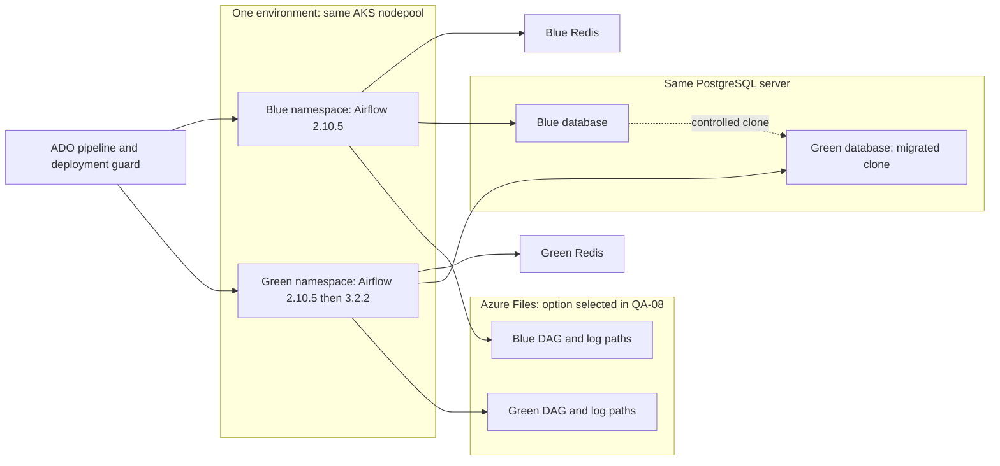
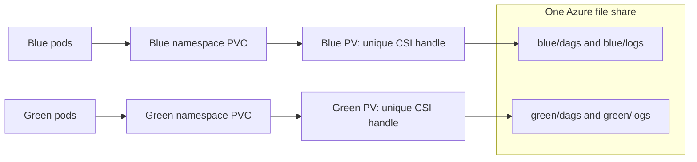
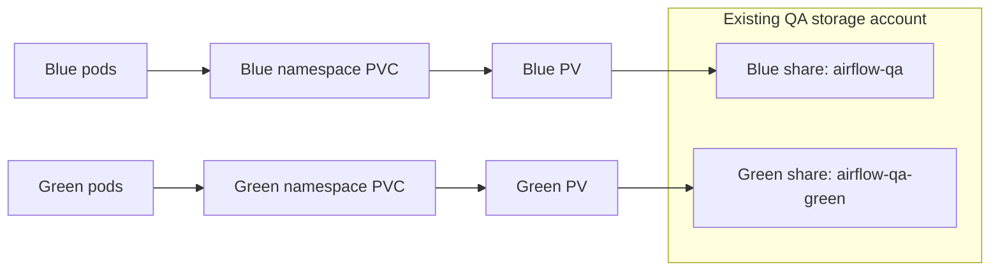
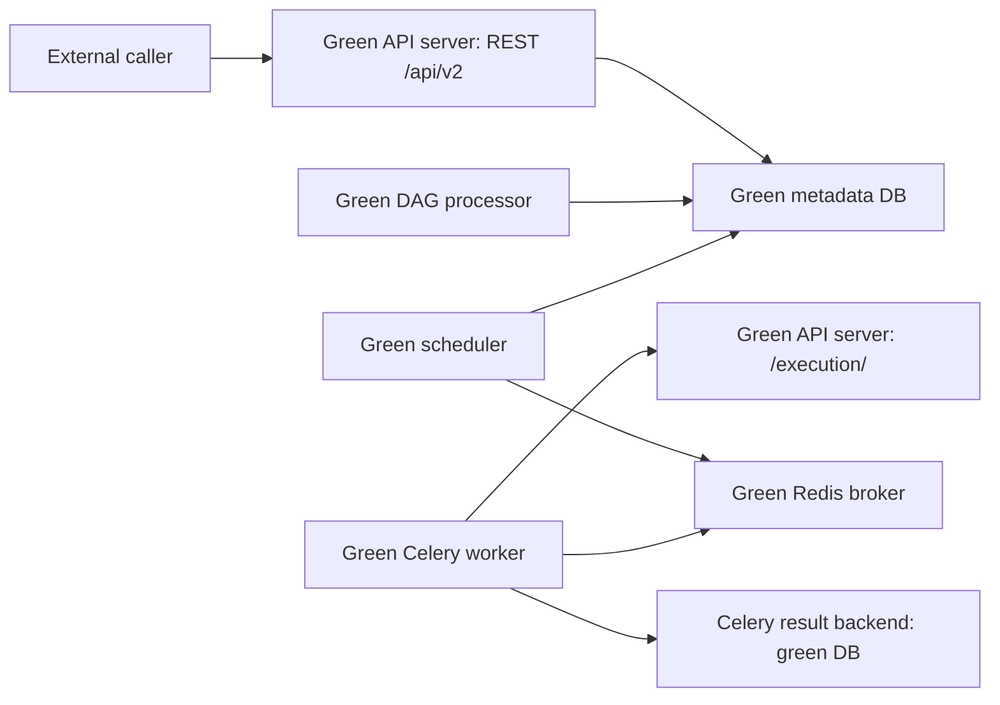

# Airflow 2.10.5 → 3.2.2 — QA-first blue/green migration

GitLab delivery backlog • 7 epics • 37 issues • Revised 22 October 2026

## Delivery approach

Roll out in this order: **QA → DEV → UAT → PROD**. QA is a new environment for technical feasibility, the migration POC and the blue/green swimlane design. Build a working Airflow 2.10.5 blue lane there first, then a second Airflow 2.10.5 green lane, and upgrade only green to **Airflow 3.2.2**. Promote the proven configuration and procedure through DEV, UAT and PROD, with an exit gate for each environment.

The lanes use the **same AKS nodepool, different namespaces, the same PostgreSQL server with different databases, and separate Redis instances**. Azure Files is an implementation choice in **QA-08**: **option-1** reuses one file share with separate lane directories; **option-2** uses separate blue/green file shares in the existing storage account. Neither option is selected yet. In QA, provision the first PostgreSQL server, blue Azure file share/PV/PVC and blue Redis before installing blue. Green reuses the server and nodepool, then uses the selected storage option; it needs its own namespace, Helm release, database/roles, Redis, service accounts/federation, secret references and volume bindings. Reuse existing registry, Nexus, Key Vault, network and identity services where applicable.

The reviewed sources are [the migration PDF](<Airflow 2.10.5 to 3.3.2 Migration Plan (Blue Green on AKS).pdf>), especially sections 2–3, 6–12 and appendix A, and [AF_B_G.md](AF_B_G.md), which describes the same original design. This backlog records the user's revised implementation requirements; the source documents retain their original content. The architecture review and differences below take precedence for this backlog. Deployment configuration has not been inspected in a live Azure/AKS environment.

**Runtime planning assumption:** retain Python 3.11 for blue and green's initial 2.10.5 installation. Use Python 3.13 for green's 3.2.2 image as proposed in the source plan, subject to MIG-01/MIG-06 confirmation in QA. The previous backlog's Python 3.14 requirement was not present in the current request. Airflow 3.2.2 lists both 3.13 and 3.14 as supported [S1], but providers, internal libraries and native packages still need proof. Record the selected Python patch version before publishing the target image; propagate any agreed change through CI, values and this backlog.

Airflow's upgrade guide permits starting from 2.7 or later and recommends the latest 2.x [S2]. Prove direct 2.10.5 → 3.2.2 on a clone in QA. Add an intermediate supported 2.x step only if evidence requires it, on green's clone only. Never upgrade blue's database to rehearse the migration.

### Architecture review and revised decisions

| Area | Source plan / previous backlog | Revised implementation and required proof | Work |
| --- | --- | --- | --- |
| Version and sequence | 3.3.2; DEV → UAT → PROD | 3.2.2; QA → DEV → UAT → PROD; QA proves feasibility before DEV migration | MIG-01–02, QA-10 |
| QA baseline | Existing v2 environment assumed | Provision QA infrastructure and deploy blue 2.10.5 before creating green | QA-01–02 |
| Green lifecycle | Build a new v3 stack directly | Deploy the second installation at 2.10.5, prove its isolation, then upgrade that release in its namespace to 3.2.2 | QA-09–10, MIG-17, MIG-19, MIG-23 |
| Compute | Dedicated green nodepool | Reuse blue's nodepool; size for overlap, shared failure impact and rollback capacity | QA-01, MIG-03, MIG-20 |
| PostgreSQL | Clone, optionally on a separate server | Same server, separate blue/green databases and roles; green migration/result backend must never target blue | QA-07, MIG-10, MIG-15–16 |
| Redis | Separate broker | Two instances in QA: first for blue, new second for green; green queue must be empty before the major-version upgrade | QA-01, QA-07, QA-09 |
| Azure Files | Separate shares | Choose option-1: one share with lane directories, or option-2: separate shares in the same account; separate PV/PVC bindings per namespace in both | QA-08, MIG-08, MIG-10 |
| Identity | Mostly existing secrets; federation discussed for later Blob logging | Namespace-specific federated credentials and service-account setup are required now for green's existing Azure access | QA-03, MIG-11 |
| Delivery | Nexus delivery to two shares | Azure DevOps (ADO) targets environment/lane and resolves its share plus directories from the QA-08 decision | QA-04–06, MIG-08 |
| Installation safety | No explicit second-install guard | Detect existing releases/workloads, fail unexpected duplicates, allow only the registered two-lane migration pair, prevent dual business activation | QA-06 |
| Rollback and retirement | Retain/delete dedicated v2 resources | Retain blue fallback artifacts; preserve shared infrastructure. Under option-1 retain the shared share; under option-2 retire only blue's share after retention | MIG-18, MIG-24, MIG-27 |

**Isolation has limits.** Both options share the nodepool, database server and storage account; option-1 also shares the physical file share. Namespaces, databases and directories provide operational separation; common storage-account credentials do not provide lane-level authorization. QA must prove the selected design's safe deployment/recovery and UAT must prove capacity and workload recovery. Separate shares on the same account do not make green physically independent of blue's storage account.

### Architecture within each environment

Names below are examples; inventory the real existing blue identifiers in DEV/UAT/PROD. Reuse is within an environment, not a shared QA/DEV/UAT/PROD metadata database or share.

| Resource | Blue lane | Green lane | Rule |
| --- | --- | --- | --- |
| AKS cluster / nodepool | Environment's existing pool; QA capacity provisioned if absent | Same pool | Match node selectors/tolerations; no new green pool by default |
| Namespace / Helm release | e.g. `airflow-qa-blue` / `airflow-qa-blue` | e.g. `airflow-qa-green` / `airflow-qa-green` | Distinct, registered identities; retain lane names across the version upgrade |
| Runtime | Airflow 2.10.5 / Python 3.11 | 2.10.5 / 3.11 first, then 3.2.2 / selected Python | Same green installation is upgraded; blue remains at 2.10.5 |
| Metadata database | e.g. `airflow_qa_blue` | e.g. `airflow_qa_green` | Same PostgreSQL server, separate DB roles/ownership and runtime grants |
| Celery result backend | Blue database | Green database | Match lane database even if a runtime uses PgBouncer |
| Celery broker | QA blue Redis | New QA green Redis | Separate service instance, endpoint and credentials; not Redis logical DB numbers on one instance |
| Azure file share | Existing environment blue share | Same share (option-1) or a new green share in the same account (option-2) | Choose in QA-08; preserve existing blue paths |
| DAGs | e.g. `blue/dags/releases/<version>/` | e.g. `green/dags/releases/<version>/` | Runtime mounts read-only; independent selection of an immutable release |
| Logs | e.g. `blue/logs/` | e.g. `green/logs/` | Writable only through intended lane mounts; historical access tested |
| PV / PVC | Blue PV(s), PVC(s) in blue namespace | New PV(s), PVC(s) in green namespace pointing to the existing share | PV names and CSI volume handles unique; one claim per binding, `Retain` [S7, S9] |
| Workload identity | Existing/environment identity and blue service-account subjects | Reuse suitable managed identity if allowed, add green namespace/service-account subjects | Namespace changes the federation subject; validate each component that needs Azure access [S8] |
| Secrets | Blue references/credentials | Green DB, Redis and auth references | Preserve Fernet key value for cloned encrypted data; use lane-specific references and new green API/JWT keys |
| Ingress and external callers | Active service hostname | Separate test hostname until cutover | Switch UI/API routes and caller configuration only after scheduling handover |

Keep the current Celery executor, SMB storage, Nexus DAG packaging and logging approach during migration. PostgreSQL 17, PgBouncer, the official Helm chart and Key Vault are source-plan assumptions to confirm in MIG-01. Do not combine this work with a PostgreSQL major upgrade or NFS/Blob adoption.



### Swimlane lifecycle and scheduling ownership

| Step | Blue lane | Green lane | Platform / DBA / release gate |
| --- | --- | --- | --- |
| 1. QA baseline | Deploy and validate 2.10.5 | Absent | QA blue infrastructure and safe test connections ready |
| 2. Second v2 installation | Remains available at 2.10.5 | Deploy 2.10.5 with its own DB/Redis and lane mounts; business DAGs paused | Guard recognizes exactly the registered pair; prove v2 parity using sandbox smoke work |
| 3. POC / rehearsal | Supplies consistent source snapshot; no simultaneous execution of the same business work | Stop green v2; replace its disposable bootstrap DB with a fresh blue clone, then migrate and deploy 3.2.2 | Capture paused/run states and Fernet key reference; block copied production destinations; scheduling held throughout replacement/migration |
| 4. Cutover | Pause/drain; stop scheduling, workers and triggerers; preserve DB, Redis and artifacts | Use a fresh cutover clone; validate, start paused, run harmless smoke, then become active | Confirm no blue execution remains; switch callers/ingress and restore only previously enabled DAGs in tiers |
| 5. Rollback drill / fallback | Restart 2.10.5 paused; reconcile intervals before resuming | Stop all scheduling/execution; retain migrated DB and evidence | Switch caller/traffic settings back; export/reconcile work already performed by green |
| 6. Accepted migration | Standby for agreed window, then retire lane-owned resources | Remains active at 3.2.2 | Keep shared nodepool/server/account and green storage; retire blue storage only as permitted by QA-08 |

Only one lane processes an environment's business workload at a time, including scheduled, manual, API, backfill and event-triggered work. Both installations may be present for comparison. Any simultaneous POC execution must use explicitly disjoint sandbox data/destinations. Pausing DAGs or switching the hostname alone does not fence all execution; control workers, triggerers, callers, autoscalers and deployment reconciliation as well. Never point a 2.x process at a migrated 3.x database.

### GitLab setup

- Create each epic with its description and completion criteria. Create the issues beneath it; the text under each issue title is its description.
- IDs such as MIG-01 and QA-01 are planning references. Preserve MIG-01–27 when updating existing issues; add E0 and QA-01–10. Replace dependency references with actual GitLab issue links and blocking relationships after creation.
- Apply `airflow-migration` to all items. Use one phase label: `phase::readiness`, `phase::build`, `phase::validation`, `phase::cutover` or `phase::stabilization`. Use `env::qa`, `env::dev`, `env::uat`, `env::prod` and lane labels where applicable. QA is an environment; a QA lead's UAT work still uses `env::uat`.
- Each issue needs one accountable assignee. Suggested owner roles below are placeholders to resolve during planning.
- Use the milestone gates below. Set dates after the QA feasibility/POC timings and inventory; dates and freeze windows in the older documents are not commitments for the revised scope.
- Split an issue by DAG owner team or external caller only when that allows independent delivery. Keep cutover commands and checkpoints in one runbook rather than separate tickets for every operational step.

### Milestones

| Milestone | Exit condition | Epics |
| --- | --- | --- |
| M0 — Readiness agreed | Inventory, scope, owners and measurable release gates agreed | E1 |
| MQ0 — QA blue ready | New QA infrastructure and first Airflow 2.10.5 installation pass baseline checks | E0: QA-01–02, QA-04–06 |
| MQ1 — QA second v2 ready | Green 2.10.5 works on the same pool/server with the QA-08 storage option, separate DB/Redis and verified federation/guard | E0: QA-03, QA-07–09 |
| MQ2 — QA POC and design accepted | Green upgraded to 3.2.2 on a clone; failure recovery, cutover and rollback proven; reusable swimlane design/runbook accepted | E0: QA-10; E2–E4 QA proof work |
| M1 — DEV migration proven | MQ2 accepted; existing DEV blue retained, green installed at 2.10.5 then upgraded; DEV cutover and rollback pass | E4: MIG-17–18 repeated in DEV |
| M2 — UAT accepted | Workflow, integration, security, load and recovery evidence accepted | E5 |
| M3 — Production ready | Production rehearsal passes and change is approved | E6: MIG-23–24 |
| M4 — Production migrated | Controlled cutover and initial validation pass | E6: MIG-25 |
| M5 — Migration closed | Stabilization accepted and v2 retirement completed | E6: MIG-26–27 |

Readiness/code/template work may proceed in parallel. Environment deployment and migration follow QA → DEV → UAT → PROD; no later environment migration starts before the previous exit gate passes. Clone each environment's own blue database, never promote QA metadata or credentials. Repeat the registered second-v2 setup, clone/migrate, cutover and rollback checks per environment; only QA requires creation of the first blue stack from scratch. E0 owns reusable setup automation; MIG-17, MIG-19 and MIG-23 own its DEV/UAT/PROD executions.

### Shared completion rule

Close an issue when its acceptance criteria pass, relevant configuration/code is reviewed and merged, and evidence is linked. Record an explicit “not applicable” reason for unused features. A known blocker to the agreed target is not an accepted exception; unresolved nonblocking risks need an owner and approval from the change owner.

Keep secret values and sensitive production records out of issue attachments. Link to access-controlled evidence instead.

### How to use the implementation examples

Examples are embedded in the issues that own the work, so they travel with the issue description when copied into GitLab. They illustrate the intended implementation; `ops/`, `helm/` and `config/` paths below are proposed deliverables to create, not existing scripts or a deployment performed by this document. Replace example resource names and `<placeholders>` using the reviewed environment/lane register. Shell examples target Bash on an ADO Linux agent or a controlled Kubernetes Job; they are not PowerShell commands.

Pin chart/image versions before adapting snippets. Custom register/profile fields are explicitly identified and must be translated into actual chart values. Preserve the existing 2.10.5 chart where needed; the current chart's documented minimum Airflow version must not be assumed to include 2.10.5 [S6, S10]. Do not execute migration/activation commands until their issue prerequisites and live guard checks pass. Rendered manifests, dumps and SQL results belong in access-controlled evidence, not public build logs.

| Implementation question | Issue containing the example |
| --- | --- |
| What identifies a lane and its shared resources? | MIG-01 resource register; QA-01 provisioning matrix |
| How does the new namespace authenticate to Azure? | QA-03 federation command and service-account manifest |
| How do Helm and ADO select and serialize deployments? | QA-04 value layering; QA-05 pipeline YAML |
| How does the active-lane guard behave and recover? | QA-06 state diagram, atomic reservation and failure cases |
| Should lanes share one file share or use separate shares? | QA-08 option-1/option-2 comparison, diagrams, manifests and decision record |
| How are green database and Redis targets isolated? | QA-07 database permissions and routing checks |
| How are migration, smoke tests and rollback performed? | QA-09/10, MIG-14/15/16/18 and MIG-25 |

---

## EPIC E1 — Establish migration scope and release gates

**Description:** Agree what must migrate, who owns it, and how the team will judge readiness. Establish measurable gates for QA feasibility, DEV migration, UAT validation and production.

**Completion criteria:** The retained DAGs and integrations have owners, the target stack is confirmed, and cutover/rollback thresholds and authority are agreed.

**Milestone:** M0 • **Label:** `phase::readiness`

### MIG-01 — Inventory the current Airflow estate and confirm scope

**Owner:** Airflow engineer • **Depends on:** None

Capture the configuration and workload needed to migrate the existing service without losing required behavior.

**Acceptance criteria**

- [ ] Inventory includes DAGs, schedules, owners, criticality, providers, custom code, API callers, authentication, secrets, executor, database, storage and deployment versions.
- [ ] Every retained DAG and external caller has an owner; unused or unowned items have a keep/retire decision.
- [ ] Critical DAGs, external side effects and recovery constraints are identified for testing and rollback reconciliation.
- [ ] Scope pins Airflow 3.2.2, confirms blue/initial-green Python 3.11 and records the target Python decision (planning default 3.13), with supported image/provider/platform prerequisites [S1].
- [ ] An environment/lane resource register identifies cluster/pool, namespaces/releases, PostgreSQL server/databases/roles, Redis instances, Azure share/paths/PVs/PVCs, identities/federation subjects, hostnames and pipeline targets. Mark each resource create/reuse and its owner.
- [ ] Existing DEV/UAT/PROD blue deployments and QA gaps are documented; the same-pool/server design, QA-08 storage choice and any environment-specific constraints are resolved before promotion.

**Implementation example — environment/lane register**

Proposed `config/airflow/qa.yaml` (custom automation input, not Helm chart values), illustrating option-1 until QA-08 records a selection. For option-2, resolve a separate share per lane as shown in QA-08. The guard and deployment generator consume the same reviewed file; operators select a lane rather than supply arbitrary database/namespace names.

```yaml
schemaVersion: 1
environment: qa
clusterContext: <qa-aks-context>
adoEnvironment: airflow-qa   # Shared lock for BOTH lanes
shared:
  nodepool: <existing-airflow-pool>
  postgresHost: <qa-server>.postgres.database.azure.com
  storageAccount: <qa-storage-account>
  fileShare: airflow-qa
lanes:
  blue:
    namespace: airflow-qa-blue
    release: airflow-qa-blue
    database: airflow_qa_blue
    metadataSecret: airflow-qa-blue-metadata
    redisResourceId: <blue-redis-resource-id>
    brokerSecret: airflow-qa-blue-broker
    claim: airflow-files-blue
    dagRoot: blue/dags
    logRoot: blue/logs
  green:
    namespace: airflow-qa-green
    release: airflow-qa-green
    database: airflow_qa_green
    metadataSecret: airflow-qa-green-metadata
    redisResourceId: <green-redis-resource-id>
    brokerSecret: airflow-qa-green-broker
    claim: airflow-files-green
    dagRoot: green/dags
    logRoot: green/logs
```

Example validation: `install green` must reject `database: airflow_qa_blue`, the blue Redis resource ID, or a green log root equal to/inside blue's log root. Compare normalized storage paths, resolved database/broker endpoints and resource IDs, not just differently named secrets. Existing blue directory names in DEV/UAT/PROD may differ from this new-QA example.

### MIG-02 — Agree responsibilities, milestones and the change window

**Owner:** Change owner • **Depends on:** MIG-01

Define delivery ownership and a practical release sequence, including business availability and production freeze constraints.

**Acceptance criteria**

- [ ] Every issue has an accountable owner; go/no-go and rollback decision makers have named deputies.
- [ ] QA blue setup, second-v2 setup, QA POC/design, DEV, UAT, rehearsal, cutover and stabilization dates follow the gated sequence and respect confirmed freeze periods.
- [ ] Cutover support, escalation contacts, stakeholder communications and change approval requirements are recorded.
- [ ] A cutover/rollback runbook has an owner and a review location; detailed timings will be completed after rehearsal.

### MIG-03 — Capture the baseline and agree release/rollback thresholds

**Owner:** Airflow engineer • **Depends on:** MIG-01

Use current operational data to define objective acceptance limits. Avoid arbitrary resource sizes or an unexplained percentage tolerance.

**Acceptance criteria**

- [ ] Capture an existing-v2 business baseline for readiness: task success, critical DAG completion times, scheduling/queue delay, DAG parse duration, component resource use, nodepool headroom, database/pool pressure and share I/O. Define the equivalent QA-blue measurements for QA-02 to add after bootstrap; QA's small POC is not a production-load baseline.
- [ ] A gate table specifies numeric performance/reliability limits, observation periods and the required critical workflow checks.
- [ ] Rollback triggers, the decision deadline and maximum service recovery time are agreed; start with the sample's 30-minute recovery target and validate feasibility in drills.
- [ ] DAG owners and Operations accept the thresholds, including any expected maintenance delay.

---

## EPIC E0 — Build QA blue and green v2 lanes and prove the migration design

**Description:** Establish the new QA environment, create the second Airflow 2.10.5 installation on reused infrastructure, then use that green installation for the Airflow 3.2.2 POC. Deliver reusable Helm/ADO automation and a tested architecture/runbook for later environments.

**Completion criteria:** MQ0, MQ1 and MQ2 pass in order; blue remains recoverable at 2.10.5; green reaches 3.2.2 on a migrated clone; isolation, installation/activation guards and rollback have evidence.

**Milestones:** MQ0–MQ2 as assigned below • **Environment:** QA • **Label:** `phase::build` unless overridden

### QA-01 — Provision the first QA Airflow infrastructure

**Owner:** Cloud engineer • **Depends on:** MIG-01, MIG-02 • **Milestone:** MQ0

Create the infrastructure missing from the new QA environment using reviewed infrastructure as code. This is the baseline infrastructure for blue, not a request for two copies of every Azure service.

**Acceptance criteria**

- [ ] QA AKS access and the intended nodepool exist; provision initial capacity if absent and record capacity for both lanes on that same pool. OIDC/workload identity, Azure Files CSI, ingress/DNS, network routes and required provider registrations are available.
- [ ] One QA PostgreSQL server, blue metadata database and roles are provisioned with TLS, private connectivity, backups and recorded restore responsibility; confirm PostgreSQL version and PgBouncer applicability.
- [ ] One QA Azure file share is provisioned with blue DAG/log directories, blue static PV/PVC bindings, `ReadWriteMany`, `Retain`, suitable SMB mount permissions and a tested backup/retention policy [S7].
- [ ] Blue's Redis instance is provisioned with required TLS/network access and broker-compatible persistence/eviction settings. Record the currently available Azure Redis service/tier and Celery compatibility; do not assume an old service SKU remains available.
- [ ] Existing registry/Nexus/Key Vault/network services are reused where suitable; QA secret references and blue identity/federation are configured without copying production write credentials.
- [ ] Infrastructure plan/apply and rerun evidence identify create/reuse operations; shared resources have lifecycle ownership outside an individual Helm uninstall.

**Implementation example — what is created versus reused**

| Resource | First QA blue installation | Second QA green installation |
| --- | --- | --- |
| Nodepool | Reuse intended QA pool; add initial capacity if missing | Reuse same pool |
| PostgreSQL | Create QA server and blue DB/roles | Reuse server; create green DB/roles |
| Azure Files | Create blue share and blue directories/PV/PVC | QA-08 option-1: reuse share; option-2: create green share in same account; add green directories/PV/PVC in either case |
| Redis | Create blue instance | Create separate green instance |
| Namespace/release | Create blue | Create distinct green |
| Azure identity | Configure QA access | Reuse suitable identity; add green federation subjects |

Attach the IaC plan with this create/reuse matrix filled with actual resource IDs. A rerun should show no unexpected replacement of the PostgreSQL server or file share.

### QA-02 — Deploy and establish the QA blue Airflow 2.10.5 baseline

**Owner:** Airflow engineer • **Depends on:** QA-01, QA-04, QA-05, QA-06 • **Milestone:** MQ0

Deploy the first installation using the existing 2.10.5 image, chart/configuration and representative DAG package, parameterized for QA blue.

**Acceptance criteria**

- [ ] Blue deploys through ADO into its registered namespace/release on the intended nodepool and reports Airflow 2.10.5/Python 3.11; image/chart/DAG digests and sanitized values are recorded.
- [ ] Metadata DB, result backend, broker, mounts, secrets and workload identity resolve to QA blue resources; no production business destinations are reachable through test configuration.
- [ ] UI/login, scheduler/worker/triggerer health, DAG imports, safe DAG execution, XCom, connection/variable lookup and task logs pass. Populate representative run history/pools/paused states for clone-validation tests.
- [ ] Restart/mount persistence and a backup/restore check pass; MIG-03 records the QA baseline and blue is accepted before green setup starts.

**Implementation example — blue baseline evidence**

Run using the registered QA context. Choose the actual scheduler pod/container after listing pods; do not assume a Deployment rather than a StatefulSet.

```bash
kubectl --context "$AF_CONTEXT" -n airflow-qa-blue get pods -o wide
helm --kube-context "$AF_CONTEXT" list -n airflow-qa-blue --all
kubectl --context "$AF_CONTEXT" -n airflow-qa-blue exec "$AF_SCHEDULER_POD" \
  -c scheduler -- airflow version
kubectl --context "$AF_CONTEXT" -n airflow-qa-blue exec "$AF_SCHEDULER_POD" \
  -c scheduler -- airflow dags list-import-errors
```

Expected: version `2.10.5`, no retained-DAG import errors, pods on the registered nodepool, and the MIG-14 smoke DAG succeeds against QA-only destinations. Save the sanitized deployment manifest and smoke run ID as the comparison point for QA-09.

### QA-03 — Create green namespace, service accounts and federated credentials

**Owner:** Platform engineer • **Depends on:** QA-02 • **Milestone:** MQ1

Create the second namespace on the same nodepool. Reuse an existing app-registration-backed service principal (SPN) or user-assigned managed identity if its permissions are suitable, but add federation for the green service-account subjects; blue's namespace subject cannot authenticate green [S8].

**Acceptance criteria**

- [ ] Green namespace, RBAC, quota/LimitRange, network policies and node placement are configured; blue resources are retained. Service-account names are explicit for runtime components and deployment/migration jobs that need Azure access.
- [ ] Required federated credentials use the cluster OIDC issuer, `system:serviceaccount:<green-namespace>:<service-account>` subject and `api://AzureADTokenExchange` audience; service-account client-ID annotations and workload-identity pod labels are rendered correctly [S8].
- [ ] Tokens and authorized Key Vault/Azure operations succeed from representative green pods; wrong namespace/subject tests fail. Separate component service accounts receive their own federation entries where needed.
- [ ] Existing blue federation remains functional. ADO service-connection federation/permissions, if used, are verified separately from pod workload identity.
- [ ] Reused CSI mount authentication is validated for the deployed driver/AKS version; workload identity for application Azure calls is not assumed to supply SMB mount authentication automatically.
- [ ] Record whether the identity is an app-registration-backed SPN or user-assigned managed identity, which service accounts actually need Azure access, and their issuer/namespace/service-account bindings. Retain existing blue credentials and add only missing green bindings using the correct identity-specific API.

**Explanation and example — one SPN across two namespaces**

When Airflow pods authenticate through standard AKS Workload Identity, one SPN can serve both installations, but each distinct **cluster OIDC issuer + namespace + Kubernetes service account** binding needs its own federated credential. The nodepool is not part of this binding. Identical service-account names in different namespaces produce different subjects [S8]; the configured issuer, subject and audience must match the presented token. See [Microsoft's federated credential requirements](https://learn.microsoft.com/en-us/entra/workload-id/workload-identity-federation-considerations).

For one `airflow-runtime` service account in each QA namespace:

| Setting | QA blue credential | QA green credential |
| --- | --- | --- |
| Target identity | Same SPN/application client ID | Same SPN/application client ID |
| Credential name | `airflow-qa-blue-runtime` | `airflow-qa-green-runtime` |
| Issuer | QA AKS cluster OIDC issuer URL | Same QA AKS cluster OIDC issuer URL |
| Subject | `system:serviceaccount:airflow-qa-blue:airflow-runtime` | `system:serviceaccount:airflow-qa-green:airflow-runtime` |
| Audience | `api://AzureADTokenExchange` | `api://AzureADTokenExchange` |

This means **one SPN, two federated credentials**, with both Kubernetes service accounts annotated with the same application/client ID. Keep blue's credential if it already matches; add green's credential without replacing blue's subject. Both namespaces authenticate as the same Azure principal and receive that principal's Azure permissions; separate federation entries do not create separate Azure permission boundaries.

| Service-account arrangement | Required pod workload federated credentials |
| --- | --- |
| One runtime service account in each of two namespaces | Two total; add one if blue already exists |
| Scheduler, worker and migration service accounts in each namespace, all needing Azure access | Six total; add three if blue's three already exist |
| Several pods using the same service account in the same namespace/cluster | One shared binding for those pods; no credential per replica |
| Same namespace/service-account names on another AKS cluster | Additional binding when the cluster issuer differs |

Create bindings only for service accounts that actually need to exchange tokens for Azure access. A service account used solely for Kubernetes permissions does not require Azure federation for that reason alone.

**SPN example — create the credential on the app registration**

For an app-registration-backed SPN, use the application federated-credential API, not `az identity federated-credential`. Proposed `green-federation.json`:

```json
{
  "name": "airflow-qa-green-runtime",
  "issuer": "<exact-QA-AKS-OIDC-issuer-URL>",
  "subject": "system:serviceaccount:airflow-qa-green:airflow-runtime",
  "description": "QA green Airflow runtime workload identity",
  "audiences": ["api://AzureADTokenExchange"]
}
```

```bash
# Application object ID from App registrations; not the service-principal object ID.
az ad app federated-credential list --id "$AF_APP_OBJECT_ID"
az ad app federated-credential create \
  --id "$AF_APP_OBJECT_ID" \
  --parameters green-federation.json
```

Resolve the exact issuer from the registered AKS cluster, preserving its actual URL including any trailing slash. The caller needs permission to manage the application's credentials; an Azure subscription role alone does not establish that permission. The create command illustrates a missing binding; use reviewed IaC or reconcile existing entries before reruns. See the [application federated-credential CLI reference](https://learn.microsoft.com/en-us/cli/azure/ad/app/federated-credential?view=azure-cli-latest).

**ADO deployment identity versus Airflow pod identity**

If the SPN is used only by the ADO pipeline to deploy Helm resources, namespace-specific AKS federated credentials are not required for deployment alone. ADO's federated service connection trusts ADO's issuer/subject; Airflow pod federation trusts the AKS issuer/service-account subject. If the same SPN serves both purposes, retain the ADO trust and add the required AKS workload bindings separately. Also verify the pipeline's namespace RBAC; successful federation does not itself grant Kubernetes deployment permissions.

**Alternative example — user-assigned managed identity federation**

Provision the namespace first. With the actual managed identity/resource group and AKS issuer resolved from IaC, create one credential for each distinct service-account subject that needs Azure access [S8]:

```bash
az identity federated-credential create \
  --name airflow-qa-green-runtime \
  --identity-name "$AF_MANAGED_IDENTITY_NAME" \
  --resource-group "$AF_IDENTITY_RESOURCE_GROUP" \
  --issuer "$AF_AKS_OIDC_ISSUER" \
  --subject system:serviceaccount:airflow-qa-green:airflow-runtime \
  --audiences api://AzureADTokenExchange
```

```yaml
apiVersion: v1
kind: ServiceAccount
metadata:
  name: airflow-runtime
  namespace: airflow-qa-green
  annotations:
    azure.workload.identity/client-id: "<application-or-managed-identity-client-id>"
---
# Pod template fragment: apply through each component's chart settings.
spec:
  template:
    metadata:
      labels:
        azure.workload.identity/use: "true"
    spec:
      serviceAccountName: airflow-runtime
```

The service-account annotation and pod label shown above apply to either identity type; use the SPN's application/client ID for the app-registration example or the user-assigned identity's client ID for this alternative. If the chart uses `airflow-worker`, `airflow-scheduler` and `airflow-migration` separately and each needs Azure access, create three federation subjects and configure their component templates accordingly. Provision credentials declaratively/idempotently in IaC; the CLI command illustrates the required binding. Verify authorized access without printing tokens/secrets, and verify that an unregistered service-account subject cannot obtain the intended access.

### QA-04 — Parameterize Helm for environment, lane and Airflow version

**Owner:** DevOps engineer • **Depends on:** MIG-01 • **Milestone:** MQ0

Refactor the existing deployment into reusable base values plus environment/lane overrides. Support the initial second 2.10.5 installation and the later green-only 3.2.2 upgrade without editing hardcoded blue identifiers.

**Acceptance criteria**

- [ ] Parameters cover environment, lane, cluster/context, namespace, release/resource names, Airflow/image/chart versions, node selectors/tolerations, DB name and secret references, broker/result backend, service accounts/client IDs, share/PV/PVC/subpaths, DAG version, ingress/base URL, replicas and migration/activation mode.
- [ ] Namespace-scoped names and cluster-scoped PV names/CSI handles cannot collide. Shared resources are referenced, not recreated/adopted by a second Helm release; no `fullnameOverride` or generated endpoint accidentally addresses blue.
- [ ] Blue-v2, green-v2 and green-v3 configurations render/lint against pinned compatible charts; validate namespace/release routing and the migration-job DB target. Record a chart transition if one chart version cannot support both versions safely [S6].
- [ ] Deploying/updating green changes only its owned resources and approved lane directories. Blue upgrade/render comparison shows no unintended change.
- [ ] Idle mode holds scheduling/execution and disables or constrains migration hooks until the correct green database is selected. Autoscalers and ADO reconciliation cannot silently reactivate the inactive lane.

**Implementation example — value layering and explicit profiles**

Proposed deliverables:

```text
helm/
  base.yaml
  qa/blue-v2.yaml
  qa/green-v2.yaml
  qa/green-v3.yaml
  profiles/standby-v2.yaml
  profiles/standby-v3.yaml
  profiles/validation-v2.yaml
  profiles/validation-v3.yaml
  profiles/active-v2.yaml
  profiles/active-v3.yaml
```

The following storage fragment uses documented chart keys where supported by the pinned version [S10]. Both claims may reference the same lane PVC when the chart renders the expected mounts; QA-08 shows the underlying pod configuration.

```yaml
# Example lane storage values; validate on BOTH pinned charts.
dags:
  persistence:
    enabled: true
    existingClaim: airflow-files-green
    subPath: green/dags/releases/poc-001
logs:
  persistence:
    enabled: true
    existingClaim: airflow-files-green
    subPath: green/logs
```

| Profile | Required rendered behavior |
| --- | --- |
| `standby` | All Airflow runtime replicas zero or components disabled; no HPA/KEDA can reactivate workers; migration/user-creation hooks disabled; shared resources retained |
| `validation` | Only explicitly permitted smoke execution; business DAGs paused; sandbox credentials/routes; other lane remains fenced for the same workload |
| `active` | Reviewed scheduler/worker/triggerer/API/DAG processor sizing and autoscaling appropriate to that Airflow version |

Translate this behavior into actual chart keys rather than adding an unconsumed `active: false` value. Read the packaged chart's values/schema; older charts use keys such as `workers.replicas`, whereas newer charts document `workers.celery.*`. Validate every Deployment, StatefulSet, Job, CronJob, HPA and ScaledObject in the output, including component-specific overrides.

```bash
# AF_CHART_PACKAGE is an immutable, version-pinned chart artifact.
helm show values "$AF_CHART_PACKAGE"
helm template airflow-qa-green "$AF_CHART_PACKAGE" \
  --namespace airflow-qa-green \
  --values helm/base.yaml \
  --values helm/qa/green-v2.yaml \
  --values helm/profiles/standby-v2.yaml > "$AF_PRIVATE_RENDERED_FILE"
```

The guard validates the rendered targets before `helm upgrade --install`. Store rendering output privately because charts can include Secret manifests. Never rely on a one-off `kubectl scale` as the durable standby setting; the next Helm deployment must preserve it.

### QA-05 — Update ADO infrastructure, Helm and Nexus deployment pipelines

**Owner:** DevOps engineer • **Depends on:** QA-04, QA-06 • **Milestone:** MQ0

Implement explicit environment/lane selection for infrastructure, Airflow and DAG deployments. GitLab hosts the work backlog; ADO remains the deployment system and Nexus remains the DAG artifact source.

**Acceptance criteria**

- [ ] Pipeline inputs validate the registered environment/lane, cluster/context, namespace/release, chart/image/DAG versions, DB/broker secret references, share paths, identity and operation (`bootstrap`, `install`, `upgrade`, `migrate`, `activate`, `rollback`). Missing or inconsistent inputs fail before writes.
- [ ] Service connections, agent network reachability, namespace RBAC, variable groups and Key Vault references work for QA blue and green. Higher-environment targets use the same templates and environment-specific permissions.
- [ ] Infrastructure/deploy stages run QA-06 preflight under a per-environment exclusive lock before creating or changing lane resources; migration and activation have explicit steps, not implicit effects of any Helm upgrade.
- [ ] Nexus DAG packages are checksum-verified and published to the selected lane release directory with a tested atomic publish/selection method on SMB. A green deployment never updates blue's selected release or cleans its files.
- [ ] Sanitized deployment manifests record all artifact versions, resolved target identifiers and guard results. Reruns update the intended existing release; failure/recovery instructions cover partially completed deployments.
- [ ] QA evidence demonstrates both lane targets, rejected wrong-target operations and safe reruns. DEV/UAT/PROD migration stages require the previous environment's recorded exit gate.

**Implementation example — one ADO lock per environment**

In ADO, create `airflow-qa`, `airflow-dev`, `airflow-uat` and `airflow-prod` Environments and add an **Exclusive lock** check to each. Both lane pipelines and all other resource-mutating pipeline paths must reference the same environment for that environment. Use `sequential`; `runLatest` is unsuitable for a queued sequence of migration operations. The protected stage must encompass inspection through final verification because the resource lock ends with the stage [S11].

```yaml
# Illustrative ADO YAML; the referenced ops script is delivered by QA-05/06.
parameters:
- name: environment
  type: string
  default: qa
  values: [qa, dev, uat, prod]
- name: lane
  type: string
  default: green
  values: [blue, green]
- name: operation
  type: string
  default: install
  values: [bootstrap, install, upgrade, migrate, activate, rollback]
- name: expectedActiveLane
  type: string
  default: blue
  values: [blue, green, none]

stages:
- stage: GuardedAirflowChange
  lockBehavior: sequential
  jobs:
  - deployment: ApplyLaneChange
    environment: airflow-${{ parameters.environment }}
    strategy:
      runOnce:
        deploy:
          steps:
          - checkout: self
          - task: AzureCLI@2
            inputs:
              # Compile-time selection; provision/authorize each connection.
              azureSubscription: sc-aks-${{ parameters.environment }}
              scriptType: bash
              scriptLocation: inlineScript
              inlineScript: |
                set -euo pipefail
                ./ops/airflow-lane.sh \
                  --environment '${{ parameters.environment }}' \
                  --lane '${{ parameters.lane }}' \
                  --operation '${{ parameters.operation }}' \
                  --expected-active '${{ parameters.expectedActiveLane }}' \
                  --run-id "$BUILD_BUILDID"
```

The script resolves/authenticates to the registered cluster, loads the register, checks live state, chooses the permitted profile, renders/checks manifests, and only then invokes Helm or a guarded migration. `install` defaults to standby; only `activate`/`rollback` may change execution ownership. A queued run rechecks expected lane and unfinished operations after acquiring the lock. Restrict service connections/environment permissions to reviewed pipelines; ordinary deployments cannot supply arbitrary active replicas or clear transition state.

Example: `environment=qa, lane=green, operation=install, expectedActiveLane=blue` may install the registered second v2 release in standby. The same request with blue's database or an unexpected third release fails before deployment. A `migrate` request requires an already reserved cutover/rehearsal operation and stopped green runtime; it does not implicitly activate green.

### QA-06 — Implement duplicate-install and active-lane guards

**Owner:** DevOps engineer • **Depends on:** QA-04 • **Milestone:** MQ0

Warn and fail when an unexpected Airflow installation already exists. An intentional blue/green migration must be distinguishable from an accidental duplicate. A generic `allowSecond=true` bypass is insufficient.

**Acceptance criteria**

- [ ] Preflight inventories Helm release records (including failed/pending/scaled-down releases), registered namespaces, Airflow workloads/jobs and ownership labels across the selected cluster. Compare with the environment/lane register; legitimate other environments are recognized, unexpected installations are reported with namespace/release details.
- [ ] Default bootstrap/install fails with a clear warning and nonzero exit when a conflicting installation exists. Controlled green creation requires an explicit migration operation, exact expected blue/green identifiers, no unregistered extra installation, distinct DB/broker and nonoverlapping writable paths; it starts inactive. Updating the exact registered release remains idempotent.
- [ ] Green migration jobs check the resolved server/database/role and schema against the allowlisted green target, explicitly reject blue, and stop if any incompatible green v2 process is still running. Credentials cannot grant green runtime writes to blue.
- [ ] A per-environment lock spans inspection and deployment to prevent two pipelines passing simultaneously; preflight rechecks immediately before mutation. Inspection/RBAC failures, drift and unresolved partial installations fail closed with actionable recovery guidance.
- [ ] Activation/cutover/rollback checks verify the other lane's scheduling/execution is stopped or safely fenced, including workers, triggerers, queued work, API/manual triggers, autoscalers and GitOps/ADO reconciliation. Deployment presence is allowed; duplicate business execution is blocked.
- [ ] Tests cover: empty environment/first install; expected blue → controlled green; same-release rerun; unexpected second/third install; conflicting DB/Redis/paths; failed/scaled-down existing release; insufficient discovery rights; concurrent pipeline runs; and attempt to activate both lanes. Guard evidence is attached without secrets.

**Implementation example — state record and allowed transitions**

Keep this control object outside both Helm releases. Bootstrap it once only after verifying actual cluster state; absence is an error during normal operations, not permission to assume that no lane is active.

```yaml
apiVersion: v1
kind: ConfigMap
metadata:
  name: airflow-lane-state
  namespace: airflow-control
data:
  environment: qa
  activeLane: blue
  phase: stable
  targetLane: none
  operationId: ""
```

`activeLane` identifies the lane authorized for execution; in `validating`, only allowlisted sandbox smoke work is permitted. The state record alone does not stop workloads. The guard must apply/verify Helm profiles, caller restrictions, autoscaler settings and live task/process checks.

```mermaid
stateDiagram-v2
  state "stable: blue authorized" as Blue
  state "draining: blue only; new work blocked" as Drain
  state "migrating: neither lane authorized" as Neither
  state "validating: green smoke only" as Validate
  state "stable: green authorized" as Green
  state "recovery required: preserve actual state" as Recover
  Blue --> Drain: reserve operation under ADO lock
  Drain --> Neither: blue fully stopped and checked
  Neither --> Validate: green clone migrated and checked
  Validate --> Green: smoke accepted; controlled resume
  Drain --> Recover: failure or cancellation
  Neither --> Recover: failure or cancellation
  Validate --> Recover: failure or cancellation
```



Recovery reacquires the same ADO lock, inspects both lanes and the recorded operation, and explicitly resumes or aborts it. Rollback follows the reverse ownership handover, with green stopped before blue validation/resume and business reconciliation from MIG-18. Never expire an operation and grant the other lane ownership solely because an agent heartbeat/ADO lock disappeared. No cleanup trap may unconditionally mark a failed handover `stable`.

**Example code — reserve an activation using optimistic concurrency**

This Python fragment is only the reservation step for an activation, after register/live preflight and the ADO lock. Environment variables come from validated inputs; it does not perform cutover. If the Kubernetes object changes after the read, `replace` fails because the original `resourceVersion` is retained [S12].

```python
import json
import os
import subprocess

context = os.environ["AF_REGISTERED_CONTEXT"]
expected = os.environ["AF_EXPECTED_ACTIVE_LANE"]
target = os.environ["AF_TARGET_LANE"]
operation = os.environ["AF_OPERATION_ID"]
if expected not in {"blue", "green"} or target not in {"blue", "green"}:
    raise SystemExit("Invalid lane for activation")
if expected == target or not operation:
    raise SystemExit("Activation requires another lane and an operation ID")

base = ["kubectl", "--context", context, "-n", "airflow-control"]
state = json.loads(subprocess.check_output(
    base + ["get", "configmap", "airflow-lane-state", "-o", "json"],
    text=True,
))
data = state["data"]
if (data.get("environment") != os.environ["AF_ENVIRONMENT"]
        or data.get("phase") != "stable"
        or data.get("activeLane") != expected
        or data.get("targetLane") != "none"
        or data.get("operationId") != ""):
    raise SystemExit("Lane state changed or another operation needs recovery")

data.update(phase="draining", targetLane=target, operationId=operation)
subprocess.run(
    base + ["replace", "-f", "-"],
    input=json.dumps(state), text=True, check=True,
)
```

Use the same expected-phase/operation/resource-version checks at every later transition. Grant state-write access only to the controlled deployment identity. A ConfigMap update is not an Airflow runtime lease: restricting all deployment paths is required. Where independent writers must remain, implement an admission policy/webhook that rejects unauthorized execution workloads; still verify termination of existing workloads during handover.

**Example guard decisions and QA failure tests**

| Request / observed state | Result |
| --- | --- |
| `bootstrap blue`, no registered release/workloads, reviewed empty state | Create first lane and initialize state through the bootstrap flow |
| `install green`, exact registered blue exists, resources distinct | Allow green standby installation; blue retains ownership |
| Ordinary install discovers an unregistered second/third release | Warn with namespace/release, fail before mutation |
| Same-release deployment while the other lane is active | Allow only a checked standby rendering |
| `activate green`, stable blue, blue fully drains | Continue through the state machine |
| Blue worker still Running/Terminating or unresolved task/queue work | Stop before green execution starts |
| Missing state, failed API discovery or unexpected controller/job | Fail closed; require inspection/recovery |
| Second ADO run or stale expected lane | Queue on lock, then reject stale state or require explicit recovery |
| Pipeline killed during migration/validation | Preserve operation ID and phase; no automatic failover |
| Scheduled Helm deploy/HPA/KEDA tries to revive standby | Deployment/activation policy rejects it; test this explicitly |

Inventory all Helm statuses and registered controllers/jobs; do not equate zero currently Running pods with an absent installation. Check controller desired/current replicas, nonterminal pods including terminating workers, Celery active/reserved/scheduled/unacknowledged work and relevant DB retry/deferred states. Empty one-queue `LLEN` or stopped schedulers alone cannot establish the invariant. Scope inventory against the reviewed cluster-wide register so legitimate other environments are not mistaken for duplicate QA lanes.

### QA-07 — Create green database and a separate Redis on reused QA infrastructure

**Owner:** DBA / Cloud engineer (assign one accountable owner) • **Depends on:** QA-02, MIG-03 • **Milestone:** MQ1

Reuse the QA PostgreSQL server, create another database for green and provision a second Redis instance. Initially green's database supports the second 2.10.5 installation; later it is replaced by a controlled blue clone.

**Acceptance criteria**

- [ ] Green database/owner/application role and credentials are distinct from blue on the same PostgreSQL server; explicit grants and negative connection/write tests prove green runtime cannot write blue. Privileged clone/migration credentials are separate from runtime credentials.
- [ ] A new green Redis instance, credentials, TLS and private routing are ready; using another logical DB or key prefix in blue Redis does not satisfy isolation.
- [ ] Metadata and Celery result-backend settings both select green's database; PgBouncer DB/user routing and direct admin/migration endpoints are verified if PgBouncer is used.
- [ ] Shared DB storage/IOPS/connections and nodepool capacity support both v2 installations and clone/migration activity without breaching the baseline; monitor the combined budget.
- [ ] Bootstrap DB recreation and clone ownership/ACL reapplication are scripted with blue explicitly protected. No retained green history is silently discarded; export any required bootstrap/POC evidence before replacement.

**Implementation example — database creation and target checks**

For a new QA green DB, after the DBA provisions owner, migration and application roles through the secret/identity process:

```sql
-- Connected to an administrative database; run once via reviewed IaC/DBA flow.
CREATE DATABASE airflow_qa_green OWNER airflow_qa_green_owner;
REVOKE ALL ON DATABASE airflow_qa_green FROM PUBLIC;
GRANT CONNECT ON DATABASE airflow_qa_green
  TO airflow_qa_green_app, airflow_qa_green_migrator;
```

Schema/table/default privileges and migration ownership must be applied separately for the chosen runtime pattern. PostgreSQL commonly grants `PUBLIC` database connectivity, so different role names alone do not prove isolation. In QA bootstrap, explicitly configure blue access for its intended principals and test green's lack of blue access; review existing environments before changing grants.

```sql
-- Expected: false for the green application role on blue.
SELECT has_database_privilege(
  'airflow_qa_green_app', 'airflow_qa_blue', 'CONNECT'
);
-- Run through the actual green runtime endpoint. Expected green DB/app role.
SELECT current_database(), current_user;
```

The runtime metadata and Celery result-backend secrets must resolve to `airflow_qa_green`, not just have green-looking secret names. Likewise, resolve the broker to green's distinct Redis resource/endpoint. Record only sanitized host/database/role/resource IDs; do not print URLs containing passwords. Re-run the permission/routing checks after clone restore because copied grants can reintroduce source permissions.

### QA-08 — Choose and implement Azure Files storage: option-1 or option-2

**Owner:** Platform engineer • **Depends on:** QA-02, QA-03 • **Milestone:** MQ1

Choose one of the two storage options during implementation, record the decision and implement/test the selected option. **option-1** uses a single physical share with lane directories. **option-2** uses separate blue/green shares within the existing storage account. Keep independent DAG selection and writable log paths in both. A PVC is namespaced and a PV binds exclusively to one claim, so both options require separate lane PV/PVC bindings [S9]. The examples below are alternatives; do not provision both layouts by default.

**Acceptance criteria**

- [ ] Record the selected `option-1` or `option-2`, rationale, actual share names/paths, capacity/cost assessment, backup/recovery design and owner before green storage deployment. Reflect it in IaC, the resource register, Helm/ADO values and the runbook.
- [ ] Static green PV(s) with unique names/CSI volume handles and green PVC(s) use `ReadWriteMany`, explicit binding and `Retain`. Under option-1 both lanes point to the existing share; under option-2 explicitly provision/validate green's separate share in the existing account before binding. No unintended dynamic share is created [S7].
- [ ] Create lane directories before using `subPath`; mount only the intended DAG/log directory into each component. DAGs are runtime-read-only, log roots do not overlap, and release jobs write only their selected lane paths.
- [ ] SMB UID/GID/mount settings are tested with the actual images. Green initialization/cleanup is restricted to its registered share/path and cannot modify blue; neither directory separation nor separate shares using a common account key are accepted as proof of authorization isolation.
- [ ] Both namespaces mount successfully on the same node and on different nodes in the same pool, including restart/rescheduling; no CSI staging/handle collision, log overwrite or DAG publication cross-effect occurs.
- [ ] Prove lane-only artifact/log recovery: option-1 restores selected files/directories without rewinding the active lane; option-2 restores the intended lane share/files while preserving the other share. Snapshots/backups and historical-log access match the selected retention design.
- [ ] Uninstall/delete tests on disposable bindings preserve retained blue files and green operation. Storage lifecycle stays outside lane Helm uninstall; under option-1 never delete the shared share, and under option-2 delete only an explicitly retired lane share after approval/retention.
- [ ] Before MQ2, accept the selected production-intended pattern and record its promotion through DEV/UAT/PROD. If QA initially uses one option for feasibility but another is selected for later environments, repeat the affected QA mount, deployment, guard, recovery and retirement tests before promotion.

**Choice comparison — no option selected yet**

| Consideration | option-1 — one share, separate lane directories | option-2 — separate shares, same storage account |
| --- | --- | --- |
| Provisioning | Reuse blue share; add green directories/bindings | Create a green share; retain the existing blue share/bindings |
| Deployment safety | Validate the lane subpath on every publication/cleanup; a root-level mistake can affect both | A job mounting only green's share cannot traverse blue through that mount; broader account credentials can still reach both |
| Recovery/retention | Share-level snapshots include both lanes; recover selected files/directories | Snapshot/backup/retention can follow each lane's share independently |
| Performance/capacity | Both lanes share one share budget; directories do not reserve IOPS/capacity | Separate share sizing/limits where supported; account limits still apply |
| Cost | Can avoid a second share's minimum provisioned allocation | May incur another minimum allocation/performance budget and protection costs; measure the actual billing model |
| Retirement | Remove only retained/approved blue directories/bindings | Retire blue's share after its fallback and retention periods |
| Common dependencies | Shared account and physical share | Shared account; separate shares do not isolate account-wide failure, networking or key access |

Azure snapshots are share-scoped but allow individual-file recovery ([snapshot documentation](https://learn.microsoft.com/en-us/azure/storage/files/storage-snapshots-files)). Both options retain storage-account limits ([scale targets](https://learn.microsoft.com/en-us/azure/storage/files/storage-files-scale-targets)). Cost depends on the billing/tier/provisioning model, not merely the number of shares ([billing guidance](https://learn.microsoft.com/en-us/azure/storage/files/understanding-billing)). Keep SMB, the existing CSI driver and the current storage tier/billing model unless the implementation decision explicitly requires otherwise; separate storage accounts are outside these two options.

**option-1 — one share, separate directories and bindings**

```text
Azure share: airflow-qa
├── blue/
│   ├── dags/releases/poc-001/
│   └── logs/
└── green/
    ├── dags/releases/poc-001/
    └── logs/
```



Example green static PV/PVC for option-1's existing SMB share [S7, S9]. Option-2 reuses this binding structure with the different share target shown below. Substitute actual resource/account names and a unique CSI handle compatible with the deployed driver. Provision the referenced mount Secret using the existing approved mechanism; it contains no values in this example. Workload federation from QA-03 does not automatically replace SMB mount authentication.

```yaml
apiVersion: v1
kind: PersistentVolume
metadata:
  name: airflow-qa-files-green
spec:
  capacity:
    storage: 20Gi             # Example binding size, not a lane storage quota
  accessModes: [ReadWriteMany]
  persistentVolumeReclaimPolicy: Retain
  storageClassName: ""       # Static binding; share is managed explicitly in IaC
  claimRef:
    namespace: airflow-qa-green
    name: airflow-files-green
  mountOptions:
    - uid=50000              # Verify actual runtime UID/GID and SMB behavior
    - gid=0
    - dir_mode=0770
    - file_mode=0660
  csi:
    driver: file.csi.azure.com
    volumeHandle: "<resource-group>#<storage-account>#airflow-qa#green"
    volumeAttributes:
      resourceGroup: "<resource-group>"
      storageAccount: "<storage-account>"
      shareName: airflow-qa
      protocol: smb
    nodeStageSecretRef:
      name: azurefiles-mount
      namespace: airflow-qa-green
---
apiVersion: v1
kind: PersistentVolumeClaim
metadata:
  name: airflow-files-green
  namespace: airflow-qa-green
spec:
  accessModes: [ReadWriteMany]
  storageClassName: ""
  volumeName: airflow-qa-files-green
  resources:
    requests:
      storage: 20Gi
```

Create blue's own binding with its namespace/PV/claim/handle; both PVs retain `shareName: airflow-qa`. The PV size does not reserve separate physical capacity or cap one directory's growth. Preserve any established blue mount options and test permission settings rather than changing shared storage defaults during rollout.

Underlying pod-spec fragment for a green component needing DAGs and logs [S14]; implement it through the pinned chart and inspect the actual rendered output:

```yaml
spec:
  containers:
  - name: airflow
    image: "<pinned-airflow-image>@sha256:<digest>"
    volumeMounts:
    - name: airflow-files
      mountPath: /opt/airflow/dags
      subPath: green/dags/releases/poc-001
      readOnly: true
    - name: airflow-files
      mountPath: /opt/airflow/logs
      subPath: green/logs
  volumes:
  - name: airflow-files
    persistentVolumeClaim:
      claimName: airflow-files-green
```

Pre-create only the intended directories through a controlled storage-bootstrap/deployer job. Mount the selected release directory directly; changing a pinned `subPath` release requires recreating affected pods through the guarded Helm deployment. Do not expect an existing bind mount to follow a replaced `current` directory/symlink. Mount DAGs where the actual component needs them and logs where logs are written/read, including the v3 API server where configured.

Example isolation test: create a harmless marker under `/opt/airflow/logs/` in green; verify it lands only in `green/logs`, and blue DAG/log checksums remain unchanged. Repeat with pods on the same node and different nodes. Test deletion on disposable bindings; retain the physical share and both lanes' data. A storage account key can allow access beyond these subdirectories, so this mount layout is operational separation, not an Azure authorization boundary.

**option-2 — separate blue/green shares in the existing storage account**

Retain blue's existing share and create only the additional green share through IaC. This example deliberately keeps the same lane directory prefixes as option-1, so the Helm subpaths, pod paths and release receipts remain compatible; the registered share is what changes.

```text
Existing QA storage account
├── share: airflow-qa                 # Existing blue share, retained
│   └── blue/
│       ├── dags/releases/poc-001/
│       └── logs/
└── share: airflow-qa-green           # New green share
    └── green/
        ├── dags/releases/poc-001/
        └── logs/
```



Use the option-1 PV/PVC structure and green pod mounts, changing green's CSI target to the new share. Blue keeps its existing target. The following is a **replacement fragment for the green PV's `spec.csi`**, not a second PV to apply alongside option-1:

```yaml
spec:
  csi:
    driver: file.csi.azure.com
    volumeHandle: "<resource-group>#<storage-account>#airflow-qa-green#green"
    volumeAttributes:
      resourceGroup: "<resource-group>"
      storageAccount: "<storage-account>"
      shareName: airflow-qa-green
      protocol: smb
    nodeStageSecretRef:
      name: azurefiles-mount
      namespace: airflow-qa-green
```

Keep the green PV/PVC names, explicit binding, `Retain`, approved mount options, DAG read-only mount and log mount from the common example. The new share's capacity/performance/backup settings are provisioned in Azure/IaC; a PVC's requested size alone does not provision those resources. Reusing the same storage account does not normally require a second account-level private endpoint, but validate the actual endpoint/DNS/network configuration and the selected mount authentication [S7].

Example resolved register storage mapping (custom automation input; choose the appropriate mapping rather than relying unconditionally on `shared.fileShare`):

```yaml
# option-1 alternative
storage:
  option: option-1
  account: <qa-storage-account>
  shares:
    blue: airflow-qa
    green: airflow-qa
---
# option-2 alternative
storage:
  option: option-2
  account: <qa-storage-account>
  shares:
    blue: airflow-qa
    green: airflow-qa-green
```

The guard checks that share targets match the selected option. Under option-1, different lane directories on the same share are required; under option-2, the registered blue/green shares must differ. In either case, check the resolved account/share/path and normalized directory roots, retain separate PV/PVC bindings, and publish only to the selected lane destination. Account-key reuse or a shared SPN with broad permissions does not establish security isolation.

Option-2 verification: create/read a green log marker, verify it is on `airflow-qa-green`, recover a test green artifact from green's snapshot/backup, and confirm blue's share/checksums are unchanged. Test lane-only share retirement on disposable resources after retention checks. Never delete the common storage account or green share when retiring blue.

**Implementation decision record — complete before provisioning green storage**

| Field | Implementation value |
| --- | --- |
| Selected option | `TBD — option-1 or option-2` |
| Owner / decision date / rationale | TBD |
| Storage account and blue/green share names | TBD |
| Lane DAG/log paths and PV/PVC/CSI handles | TBD |
| Capacity/performance, billing impact and account headroom | TBD |
| Backup, lane-only recovery, retention and retirement procedure | TBD |
| IaC / register / ADO / Helm change references | TBD |
| QA test evidence and DEV/UAT/PROD promotion plan | TBD |

### QA-09 — Deploy the second Airflow 2.10.5 installation in green

**Owner:** Airflow engineer • **Depends on:** QA-03, QA-04, QA-05, QA-06, QA-07, QA-08 • **Milestone:** MQ1

Deploy green at 2.10.5 first using the parameterized pipeline, same nodepool, new namespace, separate database/Redis and the storage option selected in QA-08. This is a required intermediate deployment, not an empty v3 install.

**Acceptance criteria**

- [ ] Green reports Airflow 2.10.5/Python 3.11 and uses the intended existing v2 image/chart/DAG release, with the green namespace/release and actual pod nodepool recorded.
- [ ] Runtime identity, DB/result-backend routing, separate Redis, service/ingress/SSO test hostname and DAG/log mounts pass positive/negative isolation checks; green bootstrap schema is 2.10.5-compatible.
- [ ] Green starts with business DAGs paused and automatic scheduling held; a tightly scoped smoke test runs only against harmless sandbox resources. No same business interval is processed by both lanes.
- [ ] Compare blue and green v2 behavior: imports, connection/variable lookup, pools, XCom, worker/triggerer operation, callbacks, UI/API and task logs. Resolve setup defects before introducing v3.
- [ ] Capture blue health/configuration/schema/file checksums before and after, plus both v2 manifests. Rerunning the second-install pipeline targets green without warning suppression or blue changes; MQ1 evidence is accepted.

**Implementation example — second-v2 deployment and parity evidence**

ADO request: `qa / green / install / expectedActiveLane=blue`. Resolve green-v2 values and the 2.10.5-compatible pinned chart; install in standby. For the controlled parity test, use the QA-only validation profile with a manual, unscheduled smoke DAG and sandbox targets; prevent overlap on the same business data.

| Evidence | Blue baseline | Green before upgrade |
| --- | --- | --- |
| Airflow/Python | 2.10.5 / 3.11 | 2.10.5 / 3.11 |
| Metadata/result backend | `airflow_qa_blue` | `airflow_qa_green` |
| Redis | Blue resource/endpoint | Distinct green resource/endpoint |
| Nodepool / storage | QA registered pool and blue share | Same pool; shared share (option-1) or registered separate green share (option-2) |
| DAG/log paths | Blue roots | Green roots |
| Smoke run / imports | Recorded run; zero errors | Recorded run; zero errors |

Capture this table and the sanitized manifests before changing green to 3.x. Setup problems found at this point belong to the second-v2 setup, not to the Airflow major-version upgrade.

### QA-10 — Complete the green 3.2.2 POC and accept the swimlane design

**Owner:** Airflow platform lead • **Depends on:** QA-09, MIG-08, MIG-12, MIG-13, MIG-14, MIG-16, MIG-18 • **Milestone:** MQ2 • **Label:** `phase::validation`

Upgrade the second installation and turn QA findings into the implementation contract for DEV/UAT/PROD. MIG-15–16 own clone/upgrade proof and MIG-18 owns recovery proof; link their evidence instead of duplicating their execution tickets.

**Acceptance criteria**

- [ ] Green v2 is stopped; a fresh blue clone replaces its disposable bootstrap database with target ownership/grants reapplied. Only green's clone is migrated. Upgrade the same green Helm release to the pinned 3.2.2 image/configuration and prove no v2 process accesses the migrated DB.
- [ ] Component health, zero retained-DAG import errors, execution API/worker communication, auth/API caller smoke checks, Fernet decryption, logs, representative schedules and selected Python/dependency tests pass on the migrated clone.
- [ ] Controlled cutover, failed-migration rebuild and rollback to blue 2.10.5 pass with timings, scheduling fencing and sample side-effect reconciliation. Preserve blue schema/artifacts and demonstrate lane-only storage recovery.
- [ ] Publish the revised architecture/resource register and blue/green swimlane runbook, including ADO stages/parameters, federation subjects, guard behavior, clone method/path, startup order, traffic switch, rollback/reconciliation, shared-resource risks and retirement ownership.
- [ ] Platform, DBA, DevOps and Operations accept technical feasibility and MQ2 exit; remaining DEV/UAT validation is named, no feasibility blocker remains, and the reusable release/template versions are frozen for DEV promotion.

**Implementation example — QA POC swimlane**

```mermaid
sequenceDiagram
  participant A as ADO and lane guard
  participant B as QA blue 2.10.5
  participant D as DBA clone and migration Job
  participant G as QA green 2.10.5 then 3.2.2
  A->>B: Validate first installation and capture baseline
  A->>G: Install second v2 in new namespace and test sandbox parity
  A->>G: Stop green v2 and confirm its queues/processes are quiet
  A->>B: Pause/drain and stop blue for controlled snapshot
  A->>A: Record neither lane authorized after stop checks
  A->>D: Clone blue to green and reapply target ownership/grants
  D->>D: Migrate clone only with pinned 3.2.2 Job
  A->>A: Authorize green validation; business work remains blocked
  A->>G: Upgrade same release; validate sandbox smoke
  A->>A: Verify and record green ownership
  A->>G: Stop for rollback drill; export outcomes
  A->>B: Restart paused, reconcile, validate and resume
```

This controlled-cutover example pauses/drains blue. A separate non-disruptive rehearsal may use a tested consistent dump while blue runs, but green must then be fenced to disjoint sandbox destinations, and that rehearsal clone cannot become the final cutover clone. Link guard transition records, both v2 manifests, migrated schema checks, smoke run IDs, actual timings and rollback reconciliation to the MQ2 decision.

---

## EPIC E2 — Make DAGs and the Python 3.13 runtime compatible

**Description:** Produce a reproducible Airflow 3.2.2 image using the Python version selected in QA (planning default 3.13) and a DAG release tested on both versions. Release compatible fixes on v2 first and preserve the exact blue fallback artifacts.

**Completion criteria:** The target dependency set installs cleanly, affected code and schedules are tested, CI checks the required runtime combinations, and both target and fallback releases are recorded.

**Milestone:** MQ2 • **Label:** `phase::build`

### MIG-04 — Fix Airflow 3 incompatibilities in DAGs and custom code

**Owner:** DAG engineering lead • **Depends on:** MIG-01

Scan and review DAGs, operators, hooks, plugins, callbacks, templates and policies for removed or changed Airflow behavior. Review applicable release changes from 3.0 through 3.2.2 [S2, S3].

**Acceptance criteria**

- [ ] Ruff AIR301/AIR302 findings are resolved; manual review covers direct metadata DB access in tasks, removed features/context keys, custom XCom handling and plugins.
- [ ] Task code uses supported SDK/provider/API interfaces; required standard-provider imports and custom plugin replacements are implemented.
- [ ] All retained DAGs import without errors on the target runtime, and tests for affected custom code and callbacks pass.
- [ ] The migration DAG release also passes on 2.10.5/Python 3.11. Defer v3-only imports/syntax/features until the relevant blue fallback is retired; a required incompatibility needs an explicit release/rollback design decision before promotion.

**Implementation example — compatibility evidence**

```bash
# In a pinned CI tool environment against the released DAG source.
ruff check --preview --select AIR301,AIR302 dags/
python -m compileall -q dags/
```

Run target-runtime import tests separately; Ruff/compile success does not prove provider availability or schedule behavior. Example review record:

| Finding | Required change | Proof |
| --- | --- | --- |
| Task reads Airflow metadata through an ORM session | Replace task-side metadata access with supported SDK/API behavior through a tested compatibility adapter | Same business result on 2.10.5 and 3.2.2; no task-side metadata SQL |
| Operator moved to a provider | Pin a compatible provider per runtime and test the chosen import on both | Zero import errors in both image jobs |
| Template/context uses removed fields | Use supported logical-date/data-interval fields where appropriate | Render comparison for representative runs, accepted by DAG owner |

### MIG-05 — Preserve scheduling and data interval behavior

**Owner:** DAG engineering lead • **Depends on:** MIG-01

Make intended scheduling behavior explicit so the upgrade does not create missed intervals, duplicate processing or an unexpected catchup burst.

**Acceptance criteria**

- [ ] Retained DAGs have reviewed schedules/timetables, timezone, catchup, start dates and active-run/task limits; behavior-sensitive defaults are explicit.
- [ ] Tests compare expected next runs and data intervals for each scheduling pattern in use, including timezone/DST boundaries where applicable.
- [ ] Critical DAG owners accept expected behavior for scheduled, manually triggered, backfilled and asset/dataset-triggered runs where used.
- [ ] Any intentional behavior change is documented, and the cutover runbook defines the expected first run and missed-interval handling.

**Implementation example — schedule comparison cases**

Record expected run creation time, logical date, interval start/end and output destination for each case; compare actual v2/v3 results against those expectations rather than just checking that a DAG succeeded.

| Case | Example input | Required evidence |
| --- | --- | --- |
| Daily interval-based schedule | UTC daily DAG, first run after cutover | Exact intended interval and output partition; no extra catchup |
| Originally paused DAG | Paused in source export | Still paused after cutover |
| `catchup=True` with downtime | Two missed intervals | Owner-approved replay list without repeating completed work |
| Local-time cron | `America/New_York` DST boundary | Explicit expected run count/timestamps and interval semantics |
| Manual/event run | Controlled manual trigger or test asset event | Expected context and downstream output; no duplicate trigger |

### MIG-06 — Resolve providers and dependencies for Python 3.13

**Owner:** Airflow engineer • **Depends on:** MIG-01

Resolve Airflow, providers, internal libraries and DAG dependencies using the Airflow 3.2.2 constraints for the selected Python (planning default 3.13) as the starting point [S4]. Review Python changes across 3.12–3.13 if that default is retained.

**Acceptance criteria**

- [ ] A clean Python 3.13 installation resolves the full target package set with Airflow pinned to 3.2.2; `pip check` passes and exact versions are recorded.
- [ ] Native dependencies have compatible wheels for the deployment architecture or a tested, reproducible build; required internal libraries install and pass their relevant tests.
- [ ] Removed standard-library usage and relevant runtime changes are reviewed against Python 3.12/3.13 porting guidance and tested where used; shared DAG source stays compatible with Python 3.11 [S5].
- [ ] Dependency changes that could affect outputs have regression coverage; no unresolved package blocker remains for the agreed target.

**Implementation example — target dependency resolution**

In an isolated Python 3.13 build environment if the planning default is accepted:

```bash
python --version
python -m pip install 'apache-airflow[celery]==3.2.2' \
  --constraint https://raw.githubusercontent.com/apache/airflow/constraints-3.2.2/constraints-3.13.txt
# Add the reviewed providers/internal libraries, retaining the Airflow pin.
python -m pip install 'apache-airflow==3.2.2' -r requirements-target.lock
python -m pip check
```

`requirements-target.lock` is a proposed reviewed deliverable containing exact dependency versions. Keep the final Airflow pin in subsequent install commands so extras cannot silently upgrade/downgrade core. Capture `airflow version`, the Python version and the sanitized package manifest. Maintain a separate 2.10.5/Python 3.11 job using its own compatible dependency set; sharing DAG source does not require identical provider versions.

### MIG-07 — Build and publish the Airflow 3.2.2/Python 3.13 image

**Owner:** DevOps engineer • **Depends on:** MIG-06

Build one immutable target image using a verified compatible base. Promote the same image through environments rather than rebuilding for production.

**Acceptance criteria**

- [ ] The image reports Airflow 3.2.2 and the pinned CPython 3.13 patch version; its base image, build inputs and package manifest are recorded.
- [ ] Build, package checks and vulnerability scan pass the team's release policy; exceptions are approved and owned.
- [ ] Required component entrypoints and provider/plugin imports pass smoke checks using the deployment user.
- [ ] The published digest is used by target components and migration jobs; the v2 image remains available for initial green installation and rollback. DAGs remain Nexus-delivered on the share, so DAG-only releases do not require an image rebuild.

### MIG-08 — Add runtime compatibility checks and release the migration DAG package

**Owner:** DevOps engineer • **Depends on:** MIG-04, MIG-05, MIG-07

Enforce the required compatibility in CI and publish traceable DAG releases using the existing delivery pipeline.

**Acceptance criteria**

- [ ] CI checks Airflow 2.10.5/Python 3.11 for the fallback release and Airflow 3.2.2/Python 3.13 for the target release, including import tests, affected unit tests and Ruff breaking-change rules.
- [ ] Required checks block merging/deployment on failure. The shared migration DAG package passes both runtime combinations; release to independent lane directories with matching checksums, preserving each lane's selected version and blue's known-good artifact.
- [ ] Compatible fixes are released to QA v2 with no blocking regression over its agreed representative cycle. Reusable promotion steps require the same QA → DEV → UAT → PROD v2 checks before each environment's cutover; MIG-17/19/23 own those later executions, so MQ2 does not depend on a later-environment deployment.
- [ ] Target/fallback DAG artifact versions and checksums are recorded; deploying the previous release and changing only green's selection is demonstrated in QA and repeated in DEV. Test the chosen publication/selection mechanism on SMB rather than assuming symlink behavior.

**Implementation example — immutable DAG delivery receipt**

Publish an artifact once to a staging directory under the selected lane, verify checksum/content, then expose the completed immutable release and roll the selected lane to its pinned release subdirectory. Do not rewrite files underneath running tasks or reuse an existing release name for different contents. Validate the publication operation on SMB and serialize it using QA-05.

```json
{
  "environment": "qa",
  "lane": "green",
  "artifact": "dags-poc-002.tar.gz",
  "sha256": "<verified-64-hex-checksum>",
  "publishedPath": "green/dags/releases/poc-002",
  "greenSelectedBefore": "green/dags/releases/poc-001",
  "greenSelectedAfter": "green/dags/releases/poc-002",
  "blueSelectedBefore": "blue/dags/releases/poc-001",
  "blueSelectedAfter": "blue/dags/releases/poc-001",
  "adoRunId": "<build-id>"
}
```

Example rollback changes only green's selection back to `green/dags/releases/poc-001` and recreates affected pods through the guarded profile. Verify the blue selection/checksums are unchanged. Each lane must remain on a compatible package throughout its fallback window, even when release selections temporarily differ for testing.

---

## EPIC E3 — Prepare the Airflow 3 platform and integrations

**Description:** Adapt the parameterized two-lane platform for Airflow 3 components, execution API communication, access control and operational visibility. Preserve lane separation while reusing the nodepool/PostgreSQL server and implementing the QA-08 storage selection.

**Completion criteria:** The target configuration deploys, runtime resources and credentials are correctly isolated, users/callers can integrate, and operators can observe and diagnose the service.

**Milestone:** MQ2 • **Label:** `phase::build`

### MIG-09 — Update Helm values and Airflow configuration for v3

**Owner:** Platform engineer • **Depends on:** MIG-01, MIG-07, QA-04

Select and pin a compatible Helm chart. Update the configuration for the API server, standalone DAG processor, scheduler, workers and triggerer where used [S2, S6].

**Acceptance criteria**

- [ ] The pinned chart supports 3.2.2 and the deployed AKS/Helm versions; QA, DEV, UAT and PROD green values render/lint and pass validation, while the preserved blue-v2 chart/values remain available [S6].
- [ ] Removed/renamed configuration is resolved using target-version tooling; required executor/provider and DAG source settings are included.
- [ ] The task execution API URL, API server, standalone DAG processor, scheduler, Celery workers and triggerer commands/probes are verified in QA; no generated URL or secret reference addresses blue. Account for Celery worker broker/result-backend access as well as task execution API access.
- [ ] Initial requests, limits and database connection budgets fit measured capacity; automatic migration/startup behavior cannot change the v2 database or start business DAGs during an idle build.

**Implementation example — green component routes**



The worker arrow to the result backend represents executor-level access where configured; task code must not use direct Airflow metadata SQL. Configure/test the execution API Service URL, for example `http://<rendered-green-api-service>:8080/execution/`, including its trailing execution path. Resolve actual Service names/ports from the pinned chart. Public REST `/api/v2` and internal `/execution/` are different interfaces; changing external callers does not configure task execution connectivity.

### MIG-10 — Define and verify the reusable lane resource contract

**Owner:** Platform engineer • **Depends on:** MIG-01, MIG-03, QA-01

Define the resource validation used in QA and each later environment. QA-01/07/08 implement the QA resources; this issue owns their reusable isolation/capacity checklist and later-environment mappings, avoiding a second provisioning ticket for the same resources.

**Acceptance criteria**

- [ ] Every environment maps green to the same PostgreSQL server as blue but a different database/roles; metadata and result-backend routes, optional PgBouncer pools and direct migration access reach green only. Reapply/verify ACLs after each clone restore.
- [ ] Each lane has its own Redis instance/credentials; no blue queue message can reach green workers and green queues are drained/empty before changing major version.
- [ ] Each environment reuses its existing nodepool and implements the QA-08 storage selection: option-1 reuses blue's share with distinct lane roots; option-2 provisions a green share in the existing account. Namespace-specific PV/PVC bindings and registered share/path targets preserve blue files and selected release. Do not add a separate green nodepool by default.
- [ ] Shared nodepool, database server and share budgets support overlap, migration and restart capacity without breaching agreed limits; environment prerequisites and owners are recorded for DEV/UAT/PROD execution tickets. Rehearsal tasks cannot write to production business systems.

### MIG-11 — Configure secrets, execution API access and network controls

**Owner:** Platform engineer • **Depends on:** MIG-09, MIG-10, QA-03, QA-07, QA-08

Supply the target with the keys and connectivity needed to run tasks securely, including internal execution API communication.

**Acceptance criteria**

- [ ] Migrated encrypted connections/variables decrypt with the retained Fernet key; required auth/JWT/API secrets are supplied consistently to the appropriate components.
- [ ] Secret references resolve from the existing secret store, and no secret values are committed to Git or exposed in logs.
- [ ] Green service accounts/federated credentials work after the v2 → v3 component/chart changes, including new DAG processor/API server accounts where used. Reused Azure/registry/SSO access is tested without changing blue subjects or rotating blue secrets.
- [ ] Tests prove required API, database, broker and business-system routes work and unnecessary routes are blocked; database access accounts for the selected executor's actual requirements.
- [ ] TLS, DNS and clock synchronization support authentication, and key rotation/recovery steps are documented.

### MIG-12 — Migrate login, roles and UI access

**Owner:** Airflow engineer • **Depends on:** MIG-01, MIG-09, MIG-11

Configure a production-appropriate auth manager and preserve required user access, using the FAB provider if selected.

**Acceptance criteria**

- [ ] The chosen auth manager/provider and supported user provisioning method are pinned and configured.
- [ ] Existing SSO/login works on the target hostname, including the required callback/redirect settings.
- [ ] Role tests demonstrate permitted actions and deny unauthorized DAG/admin actions; migrated users/roles are verified or explicitly remapped.
- [ ] Admin recovery access and the production hostname switch are documented and accepted by the access-control owner.

### MIG-13 — Update external API callers for Airflow 3

**Owner:** Integration lead • **Depends on:** MIG-01, MIG-11, MIG-12

Update each retained caller for the Airflow 3 REST API (`/api/v2`), its request/response contracts and the chosen authentication flow.

**Acceptance criteria**

- [ ] Every retained caller has a tested target endpoint, credentials/permissions and updated request/response handling.
- [ ] Caller tests cover the operations actually used, token expiry/reacquisition and relevant 3.2.2 authentication/backfill response changes [S3].
- [ ] Each caller has a cutover and fallback configuration with a named owner and a verified safe trigger/retry behavior.
- [ ] Caller owners accept QA contract/smoke evidence and the planned switch/fallback procedure; MIG-21 obtains UAT execution sign-off before production promotion.

### MIG-14 — Update monitoring, logs and a reusable smoke test

**Owner:** Operations engineer • **Depends on:** MIG-03, MIG-09, MIG-11

Provide an end-to-end check and the operational signals needed for release gates and incident response.

**Acceptance criteria**

- [ ] Health checks and dashboards cover deployed v3 components, execution API failures, task failures/queue delays, resource use and database/pool pressure.
- [ ] Alerts implement the agreed gates and route to the responsible team; representative failures demonstrate delivery.
- [ ] A harmless smoke DAG proves task execution, connection/variable lookup, pool use, XCom, callback and readable logs.
- [ ] Runbook checks also verify login and an authenticated REST API operation; instructions identify where to find component and task logs.

**Implementation example — harmless smoke DAG seed**

This seed tests scheduled infrastructure via an explicitly triggered, unscheduled Python task, readable logs and a return-value XCom. Pin a standard-provider version compatible with each runtime in MIG-06 and verify imports on both. Extend the seed with QA-only connection/variable lookup, a dedicated pool and callback checks to meet the full acceptance criteria; it is not a substitute for those tests.

```python
import pendulum
from airflow import DAG
from airflow.providers.standard.operators.python import PythonOperator


def probe():
    print("Migration smoke task executed; no business side effects")
    return {"probe": "ok"}


with DAG(
    dag_id="migration_smoke",
    schedule=None,
    start_date=pendulum.datetime(2026, 1, 1, tz="UTC"),
    catchup=False,
    is_paused_upon_creation=True,
    max_active_runs=1,
) as dag:
    PythonOperator(task_id="probe", python_callable=probe)
```

Run only through the guarded validation flow with the test DAG allowlisted; capture run/task ID, result, XCom value and UI log visibility. Example extended evidence: QA flag variable resolves to the expected non-secret value, a read-only test connection reaches its sandbox, the dedicated pool is honored, and a harmless callback receipt is observed. Do not print connection credentials or variable secret values.

---

## EPIC E4 — Prove clone migration and recovery in QA, then migrate DEV

**Description:** Establish a repeatable same-server backup, clone, migrate and validate procedure in QA. Prove controlled QA cutover and rollback before DEV promotion, then repeat against DEV's own blue source, including reconciliation of work performed while green was active.

**Completion criteria:** QA proof is accepted at MQ2; DEV passes cutover and rollback at M1; each original blue database is preserved and another engineer can execute the corrected recovery procedure.

**Milestones:** MQ2 for MIG-15–16/initial MIG-18; M1 for MIG-17 and DEV repeat of MIG-18 • **Label:** `phase::build`

### MIG-15 — Verify database backup, restore and clone procedures

**Owner:** DBA • **Depends on:** MIG-10, QA-02, QA-07

Verify backups and select a method that clones blue into another database on the same PostgreSQL server. Test `pg_dump`/`pg_restore` or an authorized database-template copy against actual Azure permissions and measured downtime. A service PITR that restores to a new server is a recovery test or explicit architecture exception, not the normal same-server green setup.

**Acceptance criteria**

- [ ] A recorded backup restores successfully in an isolated environment, with timing and retention sufficient for the agreed fallback window.
- [ ] The selected clone method produces a consistent, usable copy; required permissions, session handling and storage headroom are documented.
- [ ] Green runtime and migration credentials cannot modify blue. The separate DBA clone identity has only the source-read/administrative rights needed by the selected method; destructive target operations verify the exact green/rehearsal DB and reject blue.
- [ ] The runbook specifies consistent-snapshot semantics and source quiescence: a database-template copy requires zero source sessions, including pooled sessions; dump/restore uses the tested consistency procedure. The final cutover snapshot follows business pause/drain regardless of clone method.
- [ ] Stop all green v2 processes and migration hooks before replacing the disposable bootstrap/rehearsal DB; preserve required evidence, restore ownership/grants and sanitized test connection settings, and verify Fernet decryption. No service starts on stale/partially restored metadata.
- [ ] Capture blue schema/state and artifact checksums before/after QA rehearsals; clone/migration writes are confined to green. Record capacity/backup scope for the shared server without changing its major version.

**Implementation example — same-server dump/restore clone**

`af_blue_backup` and `af_green_restore` are PostgreSQL service names from a protected Job-mounted service file, not connection strings in source. They resolve to the same registered server and separate databases. The backup service has source-read rights; restore uses the separately controlled green migration/owner identity. Run after preflight, with green stopped and its target freshly created/empty; this example deliberately does not include a blind `DROP` or `--clean` [S13].

```bash
set -euo pipefail
AF_SOURCE_DB=$(PGSERVICE=af_blue_backup psql -XAt -v ON_ERROR_STOP=1 \
  -c 'SELECT current_database()')
AF_TARGET_DB=$(PGSERVICE=af_green_restore psql -XAt -v ON_ERROR_STOP=1 \
  -c 'SELECT current_database()')
test "$AF_SOURCE_DB" = airflow_qa_blue
test "$AF_TARGET_DB" = airflow_qa_green

PGSERVICE=af_blue_backup pg_dump \
  --format=custom --file "$AF_PRIVATE_DUMP_FILE"
pg_restore --list "$AF_PRIVATE_DUMP_FILE" > "$AF_PRIVATE_DUMP_INDEX"
pg_restore --dbname='service=af_green_restore' \
  --no-owner --no-acl --role=airflow_qa_green_owner \
  --exit-on-error "$AF_PRIVATE_DUMP_FILE"
```

Confirm server identity separately against the register and verify dump checksum/readability plus an actual restore; `--list` alone does not establish recoverability. Provisioned roles and `SET ROLE` rights must support the command. Reapply green runtime grants/default privileges after restore. For a final cutover, source pause/drain precedes the dump; a consistent rehearsal dump taken while blue runs is test-only and must be isolated from source business writes. Measure whether this method fits the window; if choosing template copy instead, prove zero source sessions and the required Azure permissions.

### MIG-16 — Rehearse and validate the metadata database upgrade

**Owner:** DBA • **Depends on:** MIG-07, MIG-09, MIG-15, QA-09

Run `airflow db migrate` from a pinned 3.2.2 Kubernetes Job against green's fresh clone of the 2.10.5 blue database. Prove the path in QA and repeat with each environment's source; never treat a successful empty-database initialization as migration evidence [S2].

**Acceptance criteria**

- [ ] The selected direct or intermediate upgrade path completes on the clone, with migration logs, duration and schema readiness checks recorded.
- [ ] Retained DAG/run/task history, XCom samples, pools, connection/variable decryption and applicable auth records pass migration-aware checks; counts are reconciled to intentional schema/retention changes.
- [ ] Source paused states and active/deferred/retry work are captured; target startup prevents accidental scheduling and each pending item has a drain/recovery decision.
- [ ] Any history cleanup has an approved retention rule and is tested on the clone; failed migration recovery recreates the clone from a known source, preserving v2.
- [ ] Preflight confirms server, green database, application/migration role, direct endpoint and expected schema before writes; use direct PostgreSQL for migration/admin jobs and validated pooled endpoints only for runtime where applicable. Schema upgrade hooks cannot bypass these checks.
- [ ] Source/green states and timings are recorded per attempt: backup, clone, optional approved cleanup, migrate, validate and recovery. A failed/partial migration is rebuilt from a fresh clone; restarting green v2 on the migrated DB or using Helm rollback as schema downgrade is prohibited.

**Implementation example — guarded migration Job command**

Use a pinned green 3.2.2 Job image, migration-only service account and direct PostgreSQL endpoint. Inject `AIRFLOW__DATABASE__SQL_ALCHEMY_CONN` through a protected green migration Secret. A proposed preflight helper (implemented under QA-06/MIG-16) must parse the resolved connection without logging its password, check host/database/role/schema and refuse blue or any unexpected target before these commands run:

```bash
set -euo pipefail
python /opt/migration/check_target.py \
  --register /opt/migration/config/qa.yaml \
  --lane green \
  --expected-schema '<recorded-source-schema-revision>'
airflow db migrate
airflow db check-migrations --migration-wait-timeout 60
airflow db check
```

The helper is a required deliverable, not a stock Airflow command. Inspect the actual DB identity, not only the Secret's name. Verify green's v2 pods/hooks are stopped and scheduling stays held; no Helm startup hook may run the migration first. Compare migrated history/pools/paused states/decryption with source expectations and record schema-aware differences. On failure preserve logs, keep green stopped and recreate a fresh clone through the guarded process; never attach the old green-v2 image to the migrated schema [S2].

### MIG-17 — Repeat the proven two-lane migration and rollback in DEV

**Owner:** Airflow engineer • **Depends on:** QA-10, MIG-08, MIG-12, MIG-14, MIG-16, MIG-18 • **Milestone:** M1 • **Environment:** DEV

Use the accepted QA templates/runbook against existing DEV blue. Build DEV green at 2.10.5 first, then upgrade that second installation to 3.2.2 on a clone of DEV blue; execute cutover and repeat the MIG-18 rollback drill with safe test targets.

**Acceptance criteria**

- [ ] The pinned target image/configuration and selected DAG release deploy with healthy components and zero retained-DAG import errors.
- [ ] QA exit is recorded before DEV migration. DEV green starts at 2.10.5 in a new namespace on DEV's same nodepool/server, using the QA-08 storage choice, a separate database/Redis, namespace federation, lane PV/PVC targets and passing ADO guards; v2 parity evidence precedes its v3 upgrade.
- [ ] The runbook covers pause/drain, stop v2, capture state, clone/migrate, start v3 safely, smoke checks and controlled resume; timings and checkpoints are recorded.
- [ ] Smoke tests and representative DAGs pass, including the first scheduled run, without duplicate external processing.
- [ ] Abort-before-activation and rollback-after-execution drills from MIG-18 pass again in DEV with caller/ingress reversal, fencing and reconciliation; shared resource contents/capacity and blue restartability remain valid.
- [ ] Defects and unclear steps are corrected in the runbook; platform/Operations record M1 DEV exit and identify any remaining UAT work. UAT migration stays blocked until this gate passes.

### MIG-18 — Prove rollback in QA and reuse the drill in later environments

**Owner:** Airflow engineer • **Depends on:** MIG-02, MIG-03, QA-09, MIG-08, MIG-12, MIG-14, MIG-16 • **Milestone:** MQ2 initially; repeat at M1/M2

First in QA, deploy upgraded green with safe test targets, execute a controlled handover and test both an abort before business execution and rollback after green produces results. Repeat the corrected drill in DEV (MIG-17) and UAT (MIG-22). Return to preserved blue rather than downgrade green's schema.

**Acceptance criteria**

- [ ] The runbook stops v3 scheduling/execution before restarting v2 paused, restores the correct v2 image/DAG release/traffic/caller settings, and prevents both stacks processing the same production work.
- [ ] A drill exports v3 run outcomes and reconciles processed/missed intervals, side effects and configuration changes before affected v2 DAGs resume.
- [ ] Critical test outputs have no unexplained duplicates or gaps; risky replays require a DAG-owner decision rather than blanket marking runs successful.
- [ ] Another engineer completes the drill within the agreed service recovery target, with separate timing for business reconciliation and all runbook corrections captured.
- [ ] Blue's database has not been schema-migrated; green queues/processes and automatic restarts are fenced before blue resumes. Restore only intended blue artifacts/configuration; option-1 forbids rewinding the common share, while option-2 restricts any storage recovery to blue's share. Preserve green evidence/historical logs and never restore the shared server as routine rollback.
- [ ] The service RTO measures restored UI/API/smoke service separately from full DAG/business recovery. Export green history/configuration/side effects for reconciliation; do not claim new green run history is merged back into blue or that external writes are undone.

**Implementation example — reconciliation after green has executed work**

| DAG / interval | Green result | Blue's knowledge | Owner-approved action before blue resume |
| --- | --- | --- | --- |
| `daily_load`, interval A | Successful upsert; output verified | Interval absent since cutover | Allow replay only after proving idempotency, or use a tested supported reconciliation procedure |
| `send_notice`, interval B | Email already sent | Interval absent | Keep paused until duplicate sending is prevented; do not blindly replay |
| `daily_load`, interval C | Task stopped mid-write | No equivalent completed run | Inspect destination transaction/output before deciding retry |
| Event-driven DAG | Event consumed on green | Event not recorded on blue | Deliberate source-event replay with deduplication and owner sign-off |

Export a receipt per decision with `dag_id`, `run_id`, logical date/interval, green outcome, external side-effect evidence, owner and planned blue action. Green run history is retained/exported; it is not merged automatically into blue. Restart blue paused, validate the v2 service, reconcile affected work, then restore only the originally enabled DAGs. Reuse QA-06's state machine and shared ADO lock; do not use a plain `helm rollback` as a database rollback.

---

## EPIC E5 — Validate business workflows and operational readiness in UAT

**Description:** Validate the target with production-like data, load and workflow patterns. Obtain evidence that the Airflow and Python changes preserve outputs and that integrations and recovery are ready for production.

**Completion criteria:** All critical DAGs pass business checks, representative remaining patterns pass, agreed service thresholds are met, and owners accept UAT evidence.

**Milestone:** M2 • **Label:** `phase::validation`

### MIG-19 — Validate DAG outputs and scheduling on the target runtime

**Owner:** QA lead • **Depends on:** MIG-17, MIG-18 • **Environment:** UAT

After DEV exit, repeat the registered second-2.10.5 setup on UAT's same pool/server and the QA-08 storage choice, with a new namespace, separate database/Redis and working identity/pipeline/guard. Record v2 parity, then upgrade UAT green using a fresh clone of UAT blue and the tested procedure. Execute workflows against safe destinations on Airflow 3.2.2 and the QA-selected Python (planning default 3.13).

**Acceptance criteria**

- [ ] UAT second-v2 setup and green-only upgrade evidence uses the accepted resource/identity/guard contract and recorded image/DAG/chart/configuration versions, passes database validation and has zero retained-DAG import errors.
- [ ] Every critical DAG passes end-to-end output, completion-time and schedule checks against expected v2/business results.
- [ ] Representative remaining DAGs cover each provider/operator/custom-code pattern in use, including retries, sensors/deferral, mapping, callbacks, XCom and asset/dataset triggering where applicable.
- [ ] Weekly/month-end or other infrequent critical behavior is observed or reproduced using controlled intervals; owners accept results and dependency-related output differences are resolved.

### MIG-20 — Validate peak load and component recovery

**Owner:** Platform engineer • **Depends on:** MIG-19

Use representative peak concurrency and controlled restarts to validate the sizing and recovery behavior of the existing executor.

**Acceptance criteria**

- [ ] Scheduling/queue delay, critical completion times and resource/database pressure meet MIG-03 limits at representative peak load.
- [ ] Scheduler/API server/worker/triggerer recovery is tested where deployed, including node drain or worker interruption for long-running tasks.
- [ ] Recovery produces no unexplained lost work or duplicate business writes; retry/replay behavior is documented for affected patterns.
- [ ] Measure shared-nodepool contention/eviction and share I/O during overlap, clone migration and peak execution; node drain accounts for both namespaces on the same pool. UAT probes actual common failure behavior rather than assuming a separate green pool.
- [ ] Final production sizing and database/broker/share limits are recorded, with evidence of shared capacity for fallback. Load/connection budgets cover both databases and new v3 API/DAG processor components; remediation stays on the agreed shared architecture unless an explicit design exception is accepted.

**Implementation example — shared-resource load and recovery scenario**

Run green at representative peak concurrency while blue is in its actual standby profile, then repeat the agreed overlap/rehearsal scenario where safe. Record node CPU/memory/evictions, share latency/throughput, DB CPU/IOPS/connections/pool waits, queue-to-start time and critical DAG completion time against MIG-03 limits. Do not publish invented capacity thresholds as production acceptance.

Example recovery drill: drain a node in the shared pool while a sandbox long-running task executes. Verify both namespaces' disruption behavior, RWX remounts, worker termination/retry semantics, no unintended blue restart, and no duplicate destination writes. A separate-green-nodepool drain test would not represent this architecture.

### MIG-21 — Validate access, integrations, logging and alerts in UAT

**Owner:** QA lead • **Depends on:** MIG-13, MIG-14, MIG-19

Verify the operational features used by real users and systems on the target release.

**Acceptance criteria**

- [ ] User and service-account login/permission tests pass, including denied access and expired/invalid credentials.
- [ ] Every retained external caller passes its required operations and safe retries against UAT.
- [ ] Running, successful, failed and retried task logs are readable within the agreed visibility limit; retained historical logs have a verified access route.
- [ ] Secret lookups, required network restrictions, TLS and representative failure alerts pass with evidence accepted by Operations and the access-control owner.

### MIG-22 — Complete the UAT cutover/rollback drill and approve UAT exit

**Owner:** Change owner • **Depends on:** MIG-18, MIG-19, MIG-20, MIG-21

Run the corrected procedure with production-like workload/data and approve the evidence needed to proceed to production rehearsal.

**Acceptance criteria**

- [ ] Timed cutover and post-execution rollback drills pass, including service recovery and critical-work reconciliation checks.
- [ ] All critical business and agreed release gates pass; remaining nonblocking defects have owners and an accepted disposition.
- [ ] DAG owners, integration owners and Operations accept the relevant evidence, with a recorded UAT exit decision.
- [ ] The versioned runbook and production rehearsal inputs reflect UAT findings.

---

## EPIC E6 — Cut over production, stabilize and retire v2

**Description:** Rehearse production migration, execute an approved cutover and confirm stable business operation. Keep the preserved v2 stack available for the agreed fallback period, then retire it with approved retention.

**Completion criteria:** Production runs the agreed target, critical outputs and service gates pass throughout stabilization, and v2 is retired after an explicit acceptance decision.

**Milestones:** M3–M5 • **Labels:** phase labels set per issue

### MIG-23 — Prepare production and rehearse on a fresh database clone

**Owner:** Platform engineer • **Depends on:** MIG-22 • **Milestone:** M3 • **Label:** `phase::validation`

After UAT exit, prepare production green on the same pool/server as production blue with the accepted QA-08 storage choice. Deploy green at 2.10.5 in its new namespace with separate DB/Redis, prove safe setup parity, then rehearse the upgrade to 3.2.2 on a fresh production-sized clone without executing production business work.

**Acceptance criteria**

- [ ] Production target resources, namespace federation, lane storage bindings, ADO parameters/guard, secret references and image/DAG/chart versions match the accepted design; second-v2 parity is recorded before green's upgrade. Blue remains healthy within agreed limits on shared infrastructure.
- [ ] A fresh clone passes the tested upgrade/validation procedure; target scheduling and business writes remain blocked during rehearsal.
- [ ] Timings cover drain assumptions, backup/clone, migration, checks, traffic switch and recovery; the approved window includes measured contingency and rollback reserve.
- [ ] Rehearsal findings are resolved and the change owner accepts the runbook; any later release/configuration drift is reviewed and affected checks rerun.
- [ ] Green is left inactive after rehearsal. Preserve required evidence and discard/recreate only its rehearsal database for the final clone; no previously migrated rehearsal state or POC side effects become production cutover state.

### MIG-24 — Confirm production go/no-go and fallback readiness

**Owner:** Change owner • **Depends on:** MIG-23 • **Milestone:** M3 • **Label:** `phase::cutover`

Make the final release decision using a concise readiness checklist and the agreed thresholds.

**Acceptance criteria**

- [ ] Change approval, cutover window, staffing/deputies, critical DAG owners and stakeholder notifications are confirmed.
- [ ] Backups and preserved v2 image/configuration/DAG release, database, broker, secrets and restart capacity are available for the full fallback period.
- [ ] DNS/ingress, TLS/SSO and external caller switch/fallback settings are verified; release freeze rules and any needed TTL change are recorded.
- [ ] The shared nodepool/server/account and selected share layout have capacity and remain protected for green operation and blue restart; lane-only restoration/cleanup is proven. Neither cutover nor fallback rewinds the shared server or, under option-1, the common share.
- [ ] The go/no-go decision confirms no blocking defect, current drill evidence, numeric triggers and a latest safe rollback decision time.

### MIG-25 — Execute production cutover and controlled DAG resume

**Owner:** Change owner • **Depends on:** MIG-24 • **Milestone:** M4 • **Label:** `phase::cutover`

Execute the approved runbook with checkpoint evidence. Stop and follow the rehearsed abort/rollback procedure if a mandatory gate fails.

**Acceptance criteria**

- [ ] Original pause/run state is captured; v2 is paused, drained and stopped, with every unfinished/deferred item resolved or assigned an approved recovery action before target activation.
- [ ] ADO environment lock, guard and activation fence pass immediately before handover; broker queues and task/process states are checked, and autoscaling/reconciliation cannot restart blue execution during green activation.
- [ ] A fresh consistent backup/clone is migrated and validated within the window; the original v2 database remains preserved and target DAGs stay paused until checks pass.
- [ ] Target component health, login, imports, smoke workflow and caller handover pass before restoring only previously enabled DAGs in owner-approved batches, critical DAGs first.
- [ ] Critical outputs, first-run intervals and release metrics meet the initial gate; phase timings, exceptions and the continue/rollback decision are recorded.
- [ ] Initial validation and named continue/rollback decisions occur at T+1h, T+4h and T+24h as applicable to the measured runbook; failure follows the rehearsed abort/rollback path, not an attempted schema downgrade.

**Implementation example — locked cutover order and abort points**

Keep the following sequence in one protected ADO stage. Each checkpoint is a live check with recorded evidence, not a delay after which success is assumed.

```mermaid
sequenceDiagram
  participant A as ADO guard under environment lock
  participant B as Blue 2.10.5
  participant D as PostgreSQL and migration Job
  participant G as Green 3.2.2
  participant C as Callers and ingress
  A->>A: Reserve expected blue-to-green operation
  A->>C: Block new business triggers; retain fallback settings
  A->>B: Capture states; pause/drain; apply Helm standby
  A->>A: Verify blue stopped, queues/tasks resolved, autoscalers fenced
  A->>A: Set neither lane authorized
  A->>D: Fresh source clone, target grants and clone-only migration
  A->>A: Authorize green validation; business work remains blocked
  A->>G: Start restricted validation; verify smoke and imports
  A->>C: Switch routes/authentication and verify callers
  A->>G: Restore enabled DAGs in owner-approved batches
  A->>A: Record stable green and release evidence
```

| Failure point | Required handling |
| --- | --- |
| Blue cannot drain | Do not start green execution; resolve or abort with a checked blue resume |
| Clone/migration fails | Green stays stopped; preserve evidence; rebuild its clone or explicitly return to blue |
| Green validation fails | Stop/check green before restoring blue; preserve failed green DB/logs |
| Failure after green business execution | MIG-18 rollback plus side-effect reconciliation; no automatic blanket replay |
| ADO agent lost at any transition | State retains operation/phase; a new locked recovery run inspects actual workloads before acting |

Do not automatically restore a previous Helm revision containing active replicas after a failed switch. Use Helm failure/rollback options only after checking the previous revision's profile, database target and the actual lane state. Manual approval, if required by the change process, should precede the locked operation rather than split the handover into unlocked stages.

### MIG-26 — Stabilize production and approve migration acceptance

**Owner:** Operations engineer • **Depends on:** MIG-25 • **Milestone:** M5 • **Label:** `phase::stabilization`

Monitor the target for a proposed 14-day fallback period, extending it when critical business cycles or defects require more evidence. Keep v2 restartable and preserve compatible fallback artifacts.

**Acceptance criteria**

- [ ] Critical DAG outputs and reliability/performance gates pass throughout the agreed observation period, including required infrequent cycles or accepted controlled tests.
- [ ] Incidents have dispositions; retirement requires no migration-related Sev1 for the preceding 7 days and no open migration-related Sev2, unless stricter agreed gates apply.
- [ ] Capacity and alert tuning are completed, and support runbooks/ownership are accepted by Operations.
- [ ] Change and critical DAG owners record acceptance and authorize ending the fallback period; any extension has a reason and review date.

### MIG-27 — Retire the Airflow 2 stack and close the migration

**Owner:** Platform engineer • **Depends on:** MIG-26 • **Milestone:** M5 • **Label:** `phase::stabilization`

Remove unused v2 infrastructure after acceptance while preserving required history and audit evidence.

**Acceptance criteria**

- [ ] Final v2 backup, DAG/configuration artifacts and historical-log access have an approved retention/access plan before resources are removed.
- [ ] Retire only blue-owned releases/namespaces, database/roles, Redis instance, PV/PVC bindings, permitted lane directories, hostnames, federation entries and secret references after retention checks; retain anything green still uses, including the Fernet key/managed identity if reused.
- [ ] Keep the shared AKS nodepool, PostgreSQL server, storage account and shared network/identity/registry services. Under option-1 retain the common share and remove only approved blue directories; under option-2 explicitly retire blue's share only after retention while preserving green's share. Removing blue PVC/PV/namespace resources cannot implicitly delete a retained share or green data; retained blue artifacts/backups have a deletion owner/date.
- [ ] CI and deployment target v3 only after fallback ends; obsolete credentials, access mappings and temporary rehearsal resources are removed as appropriate.
- [ ] Operations documentation, actual costs and migration evidence are updated, with actionable lessons and remaining work recorded.

**Implementation example — lane-owned retirement checklist**

| Resource | Blue retirement action | Green/shared resource protected |
| --- | --- | --- |
| Helm release/namespace | Remove only the registered blue release/namespace after retention checks | Green release/namespace |
| Database | Retain final backup; drop only approved blue DB/roles when retention ends | Shared PostgreSQL server and green DB/roles |
| Redis | Retire blue instance after fallback ends | Green Redis |
| PV/PVC | Remove approved blue bindings with `Retain` confirmed; no implicit Azure share deletion | Retained shares and green bindings/data |
| Share directories / share | Option-1: remove approved blue roots only. Option-2: retire only blue's share after retention | Shared share (option-1), green share (option-2), and storage account in both |
| Federation/secrets | Remove only unused blue subjects/references | Reused managed identity, Fernet key and green access |

Example acceptance evidence: after uninstalling the retired blue release in a disposable QA drill, green still mounts its DAG/log paths, the smoke DAG succeeds, and its DB/Redis routes are unchanged. Never delete the PostgreSQL server, shared storage account or nodepool during routine blue retirement. A common share under option-1 must remain; only option-2's dedicated blue share may be deleted after its explicit retention/retirement checks.

---

## Deferred improvements

Keep these outside the migration milestones. Create separate follow-up work only after stabilization and a demonstrated need:

| Candidate | Reason to proceed | Minimal acceptance |
| --- | --- | --- |
| Replace SMB DAG storage with NFS | Measured storage/parse performance cannot meet the service target | Demonstrate an agreed improvement in UAT, verify permissions/release delivery and rehearse return to SMB before production rollout. |
| Move task logs to Azure Blob | A defined retention, availability or cost requirement justifies the change | Verify running/completed/failed/retried logs, access controls and retention in UAT; rehearse fallback and preserve historical-log access. |

## Decisions to finalize during QA

These are implementation decisions with owners, not reasons to defer QA setup. Record the selected values and evidence before MQ2; measured production capacity/window is finalized after UAT and rehearsal.

| Decision | Planning position / required result | Owner and issue |
| --- | --- | --- |
| Python, providers and image | Blue/initial-green 3.11; target planning default 3.13; prove constraints/dependencies and pin image/chart digests | Airflow engineer, MIG-01/06/07/09 |
| Real resource identifiers and identity reuse | Environment/lane register replaces example names; add namespace-specific federation even when managed identity is reused | Platform engineer, MIG-01, QA-03/04 |
| Same-server clone technique | Prove permissions, consistency, ownership/grants, recovery and timings; choose dump/restore or template copy from evidence | DBA, MIG-15/16 |
| Azure Files option and SMB release/log layout | Select option-1 or option-2 in QA-08, preserve blue paths and test publication, CSI mounts, lane-only recovery and retirement | Platform/DevOps, QA-08, MIG-08 |
| Guard/fencing implementation | Explicit registered pair plus serialized deployment/activation checks; define how autoscalers, jobs and callers are fenced | DevOps engineer, QA-05/06 |
| Shared capacity and change window | QA feasibility evidence, DEV validation, UAT load proof and production-sized rehearsal; do not inherit fixed pool sizes/dates | Cloud/DBA/change owner, MIG-03/20/23/24 |

## Revision summary and source traceability

- Retained MIG-01–27 and added E0/QA-01–10: 7 epics and 37 issues. The older `af-v3-gitlab-backlog.md` remains a historical sample, not the revised implementation backlog.
- Changed the target from 3.3.2 to the requested 3.2.2; added the new QA environment and first-v2/second-v2/green-v3 gates ahead of DEV/UAT/PROD.
- Replaced the dedicated-green nodepool assumption with reuse. QA-08 leaves storage open for implementation selection: option-1 shares one file share with lane directories; option-2 uses separate shares in the same account. Both retain separate namespace bindings and capacity/recovery checks (source sections 2–3, 6 and appendix A).
- Added current-phase federation, ADO/Helm parameterization and tested installation/activation guards; the second installation must pass at 2.10.5 before the upgrade (source sections 5–6, revised by user requirements).
- Preserved clone-only schema migration, backup/restore, paused startup, timed rollback and business reconciliation, with QA proof and environment-specific repetitions (source sections 7–12).
- Corrected shared-resource retirement and retained NFS/Blob as deferred work (source sections 13–14). Kept Python 3.13 as an explicit source-plan assumption to confirm rather than the previous backlog's unsupported requirement to use 3.14.
- Embedded issue-owned resource/configuration examples, ADO/Helm snippets, federation and storage manifests, guard state/recovery diagrams, migration commands, a smoke DAG seed and cutover/reconciliation examples. These are implementation guidance to validate in QA, not a record of deployed infrastructure.

## Official references

Reviewed 22 October 2026. Versioned Airflow sources below cover 3.2.2, not the 3.3.x examples in the older plan. Product documentation does not verify the actual Azure/AKS deployment, installed driver/chart versions or application dependencies. Pin implementation versions during QA; the Helm/Azure/Kubernetes links track current documentation.

- **S1:** [Airflow 3.2.2 supported runtime/platform versions](https://airflow.apache.org/docs/apache-airflow/3.2.2/installation/prerequisites.html).
- **S2:** [Airflow 3.2.2 upgrade guide](https://airflow.apache.org/docs/apache-airflow/3.2.2/installation/upgrading_to_airflow3.html).
- **S3:** [Release changes through Airflow 3.2.2](https://airflow.apache.org/docs/apache-airflow/3.2.2/release_notes.html).
- **S4:** [Airflow 3.2.2 installation and constraints](https://airflow.apache.org/docs/apache-airflow/3.2.2/installation/installing-from-pypi.html) and [Python 3.13 constraints file](https://raw.githubusercontent.com/apache/airflow/constraints-3.2.2/constraints-3.13.txt).
- **S5:** [Python 3.13 changes and porting guidance](https://docs.python.org/3.13/whatsnew/3.13.html) and [Python 3.12 porting guidance](https://docs.python.org/3.12/whatsnew/3.12.html).
- **S6:** [Official Airflow Helm chart requirements and documentation](https://airflow.apache.org/docs/helm-chart/stable/index.html).
- **S7:** [Azure Files CSI volume provisioning and static existing-share mounts](https://learn.microsoft.com/en-us/azure/aks/create-volume-azure-files).
- **S8:** [AKS workload identity: service accounts and federated credentials](https://learn.microsoft.com/en-us/azure/aks/workload-identity-deploy-cluster).
- **S9:** [Kubernetes PV/PVC binding, namespaces and reclaim policies](https://kubernetes.io/docs/concepts/storage/persistent-volumes/).
- **S10:** [Airflow Helm chart parameter reference](https://airflow.apache.org/docs/helm-chart/stable/parameters-ref.html); check equivalent keys and supported Airflow versions in the actual pinned chart packages.
- **S11:** [ADO approvals/checks and exclusive environment locks](https://learn.microsoft.com/en-us/azure/devops/pipelines/process/approvals?view=azure-devops#exclusive-lock).
- **S12:** [Kubernetes resource versions and optimistic concurrency](https://kubernetes.io/docs/reference/using-api/api-concepts/#resource-versions).
- **S13:** [PostgreSQL 17 pg_restore options and ownership/privileges](https://www.postgresql.org/docs/17/app-pgrestore.html).
- **S14:** [Kubernetes volume subPath mounts](https://kubernetes.io/docs/concepts/storage/volumes/#using-subpath).
